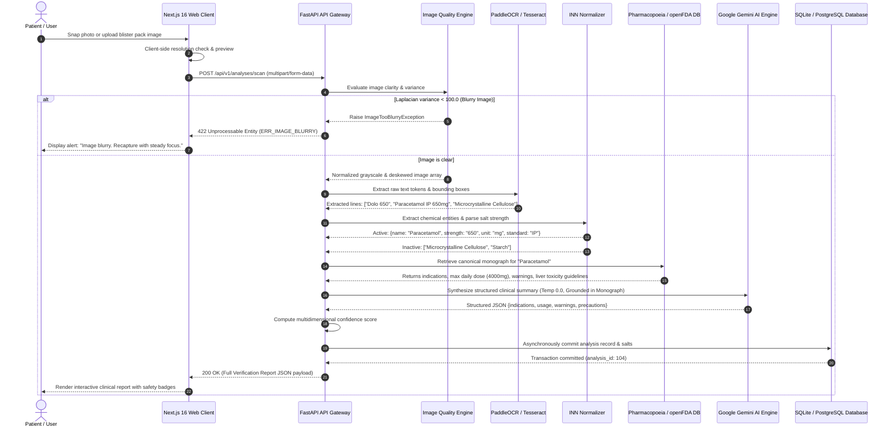
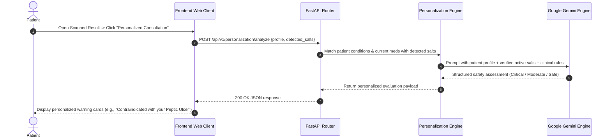
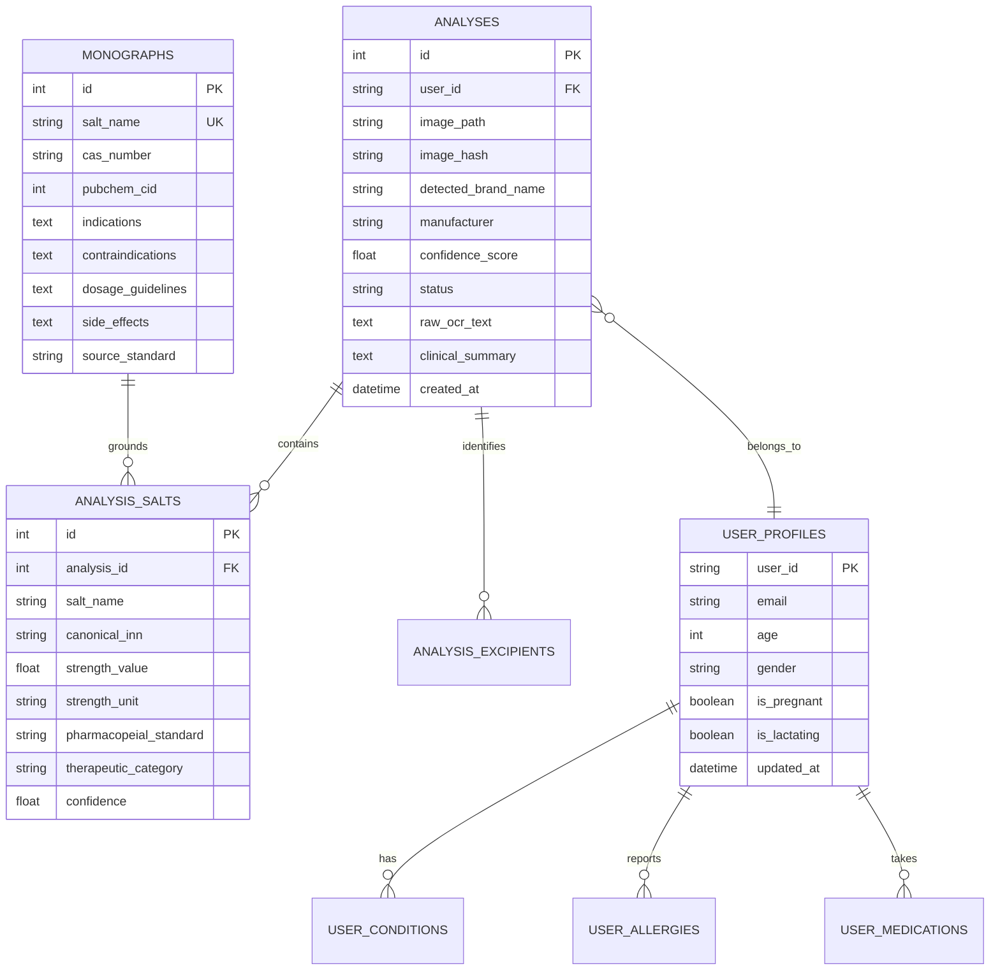

# High-Level Design (HLD) Document

## Project: MedLens
**Tagline:** Scan. Understand. Verify.  
**System Classification:** Enterprise Architectural Blueprint & System Topology  
**Document Status:** Approved & Production-Ready  
**Version:** 2.0.0  
**Target Environments:** Vercel (Frontend) + Hugging Face / Docker (Backend) + SQLite / PostgreSQL  
**Author:** MedLens Engineering Architecture Team  

---

## 1. System Overview & Architectural Vision

### 1.1 Architectural Purpose
The primary objective of the **MedLens High-Level Design (HLD)** is to define the macro-level system architecture, component boundaries, inter-service communications, data topologies, and deployment infrastructure of the MedLens platform.

### 1.2 Architectural Philosophy: Decoupled Deterministic Verification
MedLens decouples raw perception and knowledge grounding from generative language models:
$$\text{Packaging Image} \xrightarrow{\text{OpenCV}} \text{Quality Verified} \xrightarrow{\text{PaddleOCR}} \text{Spatial Tokens} \xrightarrow{\text{INN Normalizer}} \text{Canonical Salts} \xrightarrow{\text{openFDA / IP}} \text{Monograph RAG} \xrightarrow{\text{Constrained LLM}} \text{Clinical Report}$$

The Large Language Model (Google Gemini) is **never used as a factual knowledge repository**. It acts exclusively as an explanation, translation, and structured formatting agent operating on top of verified medical monograph records.

```
┌─────────────────────────────────────────────────────────────────────────────────────────────┐
│                                 MEDLENS MACRO-SYSTEM TOPOLOGY                               │
└─────────────────────────────────────────────────────────────────────────────────────────────┘

       [ CLIENT APPLICATION TIER ]
         Next.js 16 (App Router) + React 19 + Tailwind CSS + Lucide Icons + Firebase Auth
                                       │
                                       │ HTTPS / TLS 1.3 (RESTful API & Multipart Form Data)
                                       ▼
       [ API GATEWAY & ORCHESTRATION TIER ]
         FastAPI (Python 3.11/3.12) Async ASGI Engine + CORS Middleware + Pydantic v2
                                       │
         ┌─────────────────────────────┼─────────────────────────────┐
         ▼                             ▼                             ▼
   [ Vision & OCR ]           [ Verification Pipeline ]     [ Clinical Personalization ]
   • OpenCV Diagnostics       • 3-Tier INN Normalizer       • Patient Profile Matcher
   • Laplacian Blur ($\sigma^2$)  • openFDA & PubChem Fetcher   • Allergy / CKD / Ulcer Alerts
   • PaddleOCR / Tesseract    • Indian Pharmacopoeia RAG    • Drug-Drug Interaction Check
         │                             │                             │
         └─────────────────────────────┼─────────────────────────────┘
                                       │
                                       ▼
       [ PERSISTENCE & DATA STORAGE TIER ]
         SQLAlchemy 2.0 (AsyncIO) ──▶ SQLite (Local Dev) / PostgreSQL + pgvector (Cloud)
```

---

## 2. Architectural Patterns & Styles

1. **Modular Monolith Architecture (Backend):**
   * Designed as a highly cohesive, loosely coupled modular monolith in FastAPI. This eliminates network serialization overhead during the high-speed multi-stage scan pipeline while maintaining strict clean-architecture layer boundaries (`api` $\rightarrow$ `services` $\rightarrow$ `models` $\rightarrow$ `core`).
2. **Pipes and Filters Pipeline Pattern:**
   * The core scan flow executes as a sequential pipeline of deterministic filters:
     $$\text{Image Preprocess Filter} \rightarrow \text{OCR Extraction Filter} \rightarrow \text{Salt Parsing Filter} \rightarrow \text{Monograph Grounding Filter} \rightarrow \text{Personalization Filter} \rightarrow \text{Confidence Scorer}$$
3. **Repository Pattern with Async ORM:**
   * Business logic never executes raw database queries. All persistence operates through asynchronous SQLAlchemy sessions (`async_sessionmaker`), providing database engine portability between local development (`aiosqlite`) and production cloud databases (`asyncpg` / PostgreSQL).
4. **Retrieval-Augmented Generation (RAG) Pattern:**
   * Generative explanations are strictly constrained by injecting pre-fetched pharmacopeial monograph text and official openFDA labels directly into the prompt context with temperature set to $0.0$.

---

## 3. Subsystem Breakdown & Component Responsibilities

```
┌────────────────────────────────────────────────────────────────────────────────────────────────────────┐
│                                          SUBSYSTEM ARCHITECTURE                                        │
├────────────────────────────────────┬───────────────────────────────────┬───────────────────────────────┤
│ Tier / Subsystem                   │ Core Technologies                 │ Primary Responsibilities      │
├────────────────────────────────────┼───────────────────────────────────┼───────────────────────────────┤
│ 1. Presentation Tier               │ Next.js 16, React 19,             │ • Responsive UI / UX Dashboard │
│    (Frontend)                      │ Tailwind CSS, Firebase Client SDK,│ • WebRTC camera frame capture │
│                                    │ HTML5 Canvas API                  │ • Client-side image validation│
│                                    │                                   │ • Interactive report cards    │
├────────────────────────────────────┼───────────────────────────────────┼───────────────────────────────┤
│ 2. API Ingress & Gateway           │ FastAPI, Starlette,               │ • Routing & URL dispatching   │
│    (Backend Router)                │ Pydantic v2, CORS Middleware      │ • Payload schema validation   │
│                                    │                                   │ • Multipart file ingestion    │
│                                    │                                   │ • Centralized error handling  │
├────────────────────────────────────┼───────────────────────────────────┼───────────────────────────────┤
│ 3. Image Preprocessing & OCR       │ OpenCV (cv2), NumPy,              │ • Laplacian blur detection    │
│    Subsystem                       │ PaddleOCR, Pytesseract            │ • Adaptive binarization (Otsu)│
│                                    │                                   │ • Perspective deskewing       │
│                                    │                                   │ • Spatial text line clustering│
├────────────────────────────────────┼───────────────────────────────────┼───────────────────────────────┤
│ 4. Pharmaceutical Verification     │ Python Regex, Levenshtein Distance│ • Salt vs. Excipient parsing  │
│    & Normalization Engine          │ openFDA REST API, PubChem REST,   │ • Alias-to-INN mapping        │
│                                    │ Indian Pharmacopoeia SQLite Monos │ • Monograph cross-referencing │
│                                    │                                   │ • Multi-factor confidence math│
├────────────────────────────────────┼───────────────────────────────────┼───────────────────────────────┤
│ 5. Clinical Safety &               │ Google Gemini 2.5 Flash SDK,      │ • Patient allergy checks      │
│    Personalization Engine          │ Pydantic Structured Outputs       │ • Drug-condition alerts       │
│                                    │                                   │ • Clinical usage advice       │
├────────────────────────────────────┼───────────────────────────────────┼───────────────────────────────┤
│ 6. Persistence & Storage Tier      │ SQLAlchemy 2.0 Async,             │ • Analysis history logs       │
│                                    │ aiosqlite / asyncpg, Firebase Auth│ • Monograph knowledge base    │
│                                    │                                   │ • User profile records        │
└────────────────────────────────────┴───────────────────────────────────┴───────────────────────────────┘
```

---

## 4. End-to-End System Sequence & Data Flows

### 4.1 Packaging Scan & Verification Sequence Diagram



### 4.2 Personalized Contraindication Analysis Sequence



---

## 5. Data Architecture & Entity-Relationship Model



---

## 6. External System Integrations & Third-Party APIs

```
┌────────────────────────────────────────────────────────────────────────────────────────┐
│                              EXTERNAL INTEGRATION TOPOLOGY                             │
└────────────────────────────────────────────────────────────────────────────────────────┘

 [ MedLens Backend ]
        │
        ├── 1. openFDA Drug Labeling API (https://api.fda.gov/drug/label.json)
        │      • Query: ?search=openfda.substance_name:"paracetamol"
        │      • Ingestion: Official clinical indications, boxed warnings, adverse reactions.
        │
        ├── 2. PubChem PUG REST API (https://pubchem.ncbi.nlm.nih.gov/rest/pug)
        │      • Query: /compound/name/paracetamol/cids/JSON
        │      • Ingestion: Chemical compound identity, CID, IUPAC nomenclature, 2D structure.
        │
        ├── 3. Google Gemini 2.5 Flash / 1.5 Flash API
        │      • Purpose: High-speed, constrained clinical summarization & personalized reasoning.
        │      • Configuration: Temperature 0.0, strict JSON schema output validation.
        │
        └── 4. Firebase Authentication (Google Identity Platform)
               • Client Protocol: Google OAuth 2.0 & Firebase Auth REST tokens.
               • Scope: Stateless user identity token validation (`Bearer <jwt>`).
```

---

## 7. Cloud Deployment & Infrastructure Topology

### 7.1 Production Dual-Cloud Architecture
* **Frontend Tier (Vercel):**
  * Next.js 16 App Router hosted on Vercel's global Edge network.
  * Auto-deploys via GitHub CI/CD from branch `main`.
  * Public URL: `https://med-lens-lilac.vercel.app`.
  * Environment configuration: `NEXT_PUBLIC_API_URL` pointing to backend API.
* **Backend Tier (Hugging Face Spaces / Containerized Docker):**
  * Containerized FastAPI application running under ASGI server.
  * Auto-provisions system dependencies via `packages.txt` (`libgl1`, `libglib2.0-0`, `tesseract-ocr`).
  * Public URL: `https://zephyr696969-medlens-backend.hf.space`.
  * Full CORS whitelist configured with regular expression (`allow_origin_regex=r".*"`).

```
  [ End User Mobile / Browser ]
                │
                ├────────────────────────────────────────┐
                │ HTTPS (Web App Traffic)                │ HTTPS (API Scans / Health)
                ▼                                        ▼
  [ Vercel Edge Global CDN ]               [ Hugging Face / Docker Container ]
  Next.js 16 App Router                   FastAPI ASGI Application
  • Dashboard, Camera UI                   • Preprocessing & OCR Pipeline
  • Firebase Auth Client                   • INN Normalizer & openFDA RAG
  • Result Presentation                   • SQLite / PostgreSQL Storage
```

---

## 8. Security, Privacy & Zero-Trust Architecture

1. **Zero Secret Leakage Guarantee:**
   * No API keys (Google Gemini, Firebase Private Keys, Database Passwords) are committed to Git. All secrets are loaded through `pydantic-settings` via runtime environment variables.
2. **Ephemeral Image Storage:**
   * Uploaded packaging photos are processed in memory buffer streams or written to transient disk directories with immediate lifecycle cleanup post-analysis to prevent medical data accumulation.
3. **CORS & Input Sanitization:**
   * Strict filetype verification checking magic byte headers (`image/jpeg`, `image/png`, `image/webp`) preventing malicious executable script execution.
   * Maximum upload payload enforced at $15\text{ MB}$.
4. **Content Security Policy (CSP) & Transport Security:**
   * All network transit enforced over TLS 1.3.

---

## 9. Fault Tolerance & Graceful Degradation Matrix

| Failure Mode | Root Cause | Graceful Degradation Strategy |
| :--- | :--- | :--- |
| **PaddleOCR Engine Timeout** | High container CPU contention | Automatically falls back to **Tesseract OCR Engine** to extract text. |
| **openFDA External API Downtime** | openFDA rate limit or network outage | Falls back to internal **Indian Pharmacopoeia SQLite Monograph Knowledge Base** pre-seeded locally. |
| **Gemini AI API Network Failure** | Upstream Google API outage | Returns deterministic structured verification report directly from extracted monographs without generative explanation. |
| **Camera WebRTC Hardware Inaccessible** | Browser permission denied | Client interface immediately switches to drag-and-drop file upload picker with sample packaging gallery. |
