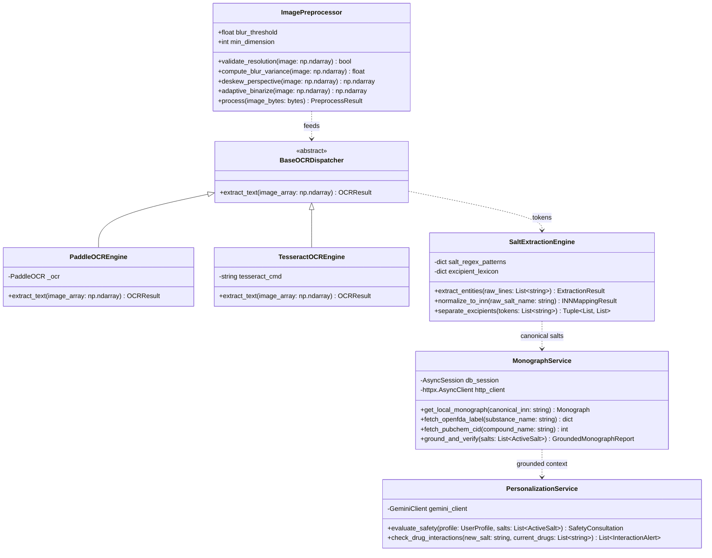
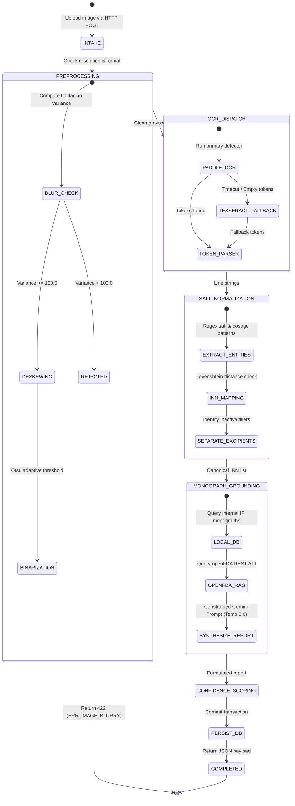

# Low-Level Design (LLD) Document

## Project: MedLens
**Tagline:** Scan. Understand. Verify.  
**System Classification:** Micro-Level Software Engineering Specification & Class Blueprint  
**Document Status:** Approved & Production-Ready  
**Version:** 2.0.0  
**Target Runtime:** Python 3.11/3.12 (FastAPI Async) / TypeScript (Next.js 16 + React 19)  
**Author:** MedLens Software Engineering Team  

---

## 1. Introduction & Implementation Principles

### 1.1 Purpose of this Document
The **MedLens Low-Level Design (LLD)** provides a granular, class-by-class, and function-by-function technical specification. It documents exact class diagrams, mathematical equations, database DDL schemas, Pydantic validation models, OpenAPI endpoint contracts, algorithmic pseudocode, state machines, and unit testing suites.

### 1.2 Core Coding Standards & Engineering Principles
* **Type Safety & Strict Validation:** Full typing across both tiers using Python `typing` with **Pydantic v2** models on the backend and strict **TypeScript 5+** interfaces on the frontend.
* **Asynchronous Non-Blocking Execution:** All I/O operations (file ingestion, OCR invocation, external API HTTP calls with `httpx.AsyncClient`, and database queries via `SQLAlchemy.ext.asyncio`) run inside the Python `asyncio` event loop.
* **Separation of Concerns (Clean Architecture):**
  * `app.models`: Database ORM entity models.
  * `app.schemas`: Pydantic request/response validation schemas.
  * `app.services`: Pure domain business logic and algorithms.
  * `app.api.v1`: HTTP route handlers and serialization controllers.

---

## 2. Detailed Object-Oriented Class Diagrams



---

## 3. Mathematical Formulations & Algorithmic Specifications

### 3.1 Preprocessing: Laplacian Blur Variance & Image Diagnostics
To prevent executing computationally expensive OCR models on out-of-focus photographs, the image is converted to a single-channel 8-bit grayscale matrix $I(x,y)$. The 2D discrete Laplacian operator $\nabla^2 I$ is computed using a $3 \times 3$ second-derivative kernel:
$$K_L = \begin{bmatrix} 0 & 1 & 0 \\ 1 & -4 & 1 \\ 0 & 1 & 0 \end{bmatrix}$$

The Laplacian variance $\sigma_L^2$ measures high-frequency edge transition density:
$$\sigma_L^2 = \frac{1}{M \cdot N} \sum_{x=0}^{M-1} \sum_{y=0}^{N-1} \left( \nabla^2 I(x,y) - \mu_L \right)^2, \quad \text{where } \mu_L = \frac{1}{M \cdot N}\sum_{x,y}\nabla^2 I(x,y)$$

* **Decision Boundary:**
  $$\text{Status} = \begin{cases} \text{ACCEPTED}, & \text{if } \sigma_L^2 \ge 100.0 \\ \text{REJECTED } (\texttt{ERR\_IMAGE\_BLURRY}), & \text{if } \sigma_L^2 < 100.0 \end{cases}$$

### 3.2 INN Normalization: Normalized Levenshtein Distance
Active drug salts are frequently misspelled by OCR or stylized on packaging. MedLens matches candidate tokens $s_1$ against canonical pharmacopeial dictionary entries $s_2$ using normalized edit distance:
$$\text{Sim}(s_1, s_2) = 1.0 - \frac{\text{Levenshtein}(s_1, s_2)}{\max(\text{len}(s_1), \text{len}(s_2))}$$

* If $\text{Sim}(s_1, s_2) \ge 0.85$, the candidate is mapped to the canonical International Nonproprietary Name (INN).

### 3.3 Multidimensional Confidence Scoring Formulation
The overall verification confidence score $C \in [0.0, 1.0]$ is a weighted linear combination of four decoupled verification dimensions:
$$C = w_1 C_{\text{diag}} + w_2 C_{\text{ocr}} + w_3 C_{\text{salt}} + w_4 C_{\text{mono}}$$

Where:
* $C_{\text{diag}} = \min(1.0, \sigma_L^2 / 500.0)$: Visual edge clarity score.
* $C_{\text{ocr}} = \frac{1}{K}\sum_{i=1}^K \text{conf}(t_i)$: Average token detection confidence from OCR bounding boxes.
* $C_{\text{salt}} \in \{0.5, 0.85, 1.0\}$: Salt normalization certainty (Exact match = $1.0$, Fuzzy match = $0.85$, Regex fallback = $0.5$).
* $C_{\text{mono}} \in \{0.0, 0.7, 1.0\}$: External grounding validity ($1.0$ if present in openFDA and IP, $0.7$ if in local DB only, $0.0$ if ungrounded).
* **Weights:** $w_1 = 0.15, \quad w_2 = 0.25, \quad w_3 = 0.35, \quad w_4 = 0.25$ ($\sum w_i = 1.0$).

---

## 4. Complete Database DDL & Schema Data Dictionary

```sql
-- Analyses Table: Master record for every packaging scan
CREATE TABLE analyses (
    id INTEGER PRIMARY KEY AUTOINCREMENT,
    user_id VARCHAR(128) NULL,
    image_path VARCHAR(512) NOT NULL,
    image_hash VARCHAR(64) NOT NULL,
    detected_brand_name VARCHAR(255) NULL,
    manufacturer VARCHAR(255) NULL,
    confidence_score FLOAT NOT NULL DEFAULT 0.0,
    status VARCHAR(32) NOT NULL DEFAULT 'completed',
    raw_ocr_text TEXT NULL,
    clinical_summary TEXT NULL,
    created_at TIMESTAMP NOT NULL DEFAULT CURRENT_TIMESTAMP
);

CREATE INDEX idx_analyses_user_id ON analyses(user_id);
CREATE INDEX idx_analyses_image_hash ON analyses(image_hash);

-- Analysis Salts Table: Extracted Active Pharmaceutical Ingredients (APIs)
CREATE TABLE analysis_salts (
    id INTEGER PRIMARY KEY AUTOINCREMENT,
    analysis_id INTEGER NOT NULL,
    salt_name VARCHAR(255) NOT NULL,
    canonical_inn VARCHAR(255) NOT NULL,
    strength_value FLOAT NOT NULL,
    strength_unit VARCHAR(32) NOT NULL,
    pharmacopeial_standard VARCHAR(16) DEFAULT 'IP',
    therapeutic_category VARCHAR(128) NULL,
    confidence FLOAT NOT NULL DEFAULT 1.0,
    FOREIGN KEY (analysis_id) REFERENCES analyses(id) ON DELETE CASCADE
);

CREATE INDEX idx_salts_analysis_id ON analysis_salts(analysis_id);
CREATE INDEX idx_salts_canonical_inn ON analysis_salts(canonical_inn);

-- Monographs Table: Canonical Clinical Grounding Knowledge Base
CREATE TABLE monographs (
    id INTEGER PRIMARY KEY AUTOINCREMENT,
    salt_name VARCHAR(255) NOT NULL UNIQUE,
    canonical_inn VARCHAR(255) NOT NULL,
    cas_number VARCHAR(64) NULL,
    pubchem_cid INTEGER NULL,
    indications TEXT NOT NULL,
    contraindications TEXT NOT NULL,
    dosage_guidelines TEXT NOT NULL,
    side_effects TEXT NOT NULL,
    source_standard VARCHAR(32) DEFAULT 'Indian Pharmacopoeia'
);

CREATE UNIQUE INDEX idx_monographs_salt_name ON monographs(salt_name);

-- User Profiles Table: Patient medical conditions for personalization
CREATE TABLE user_profiles (
    user_id VARCHAR(128) PRIMARY KEY,
    email VARCHAR(255) NOT NULL,
    age INTEGER NULL,
    gender VARCHAR(32) NULL,
    is_pregnant BOOLEAN DEFAULT 0,
    is_lactating BOOLEAN DEFAULT 0,
    conditions TEXT DEFAULT '[]', -- JSON string array: ["CKD", "Hypertension"]
    allergies TEXT DEFAULT '[]',  -- JSON string array: ["Penicillin", "NSAIDs"]
    current_medications TEXT DEFAULT '[]', -- JSON string array: ["Metformin 500mg"]
    updated_at TIMESTAMP NOT NULL DEFAULT CURRENT_TIMESTAMP
);
```

---

## 5. API Endpoint Specifications & OpenAPI Contracts

### 5.1 Endpoint: `POST /api/v1/analyses/scan`
* **Purpose:** Upload medicine package image, execute full analysis pipeline, and return verification report.
* **Content-Type:** `multipart/form-data`
* **Request Parameters:**
  * `file`: Binary file stream (image formats `.jpg`, `.jpeg`, `.png`, `.webp`, max $15\text{ MB}$).
  * `user_id`: Optional string identifying the authenticated patient.

#### Response Payload (`200 OK` Application/JSON):
```json
{
  "id": 104,
  "detected_brand_name": "Dolo 650",
  "manufacturer": "Micro Labs Ltd.",
  "confidence_score": 0.94,
  "status": "completed",
  "raw_ocr_text": "Dolo 650\nEach tablet contains:\nParacetamol IP 650mg\nExcipients q.s.",
  "active_salts": [
    {
      "salt_name": "Paracetamol",
      "canonical_inn": "Paracetamol",
      "strength_value": 650.0,
      "strength_unit": "mg",
      "pharmacopeial_standard": "IP",
      "therapeutic_category": "Analgesic & Antipyretic",
      "confidence": 0.98
    }
  ],
  "excipients": [
    "Microcrystalline Cellulose",
    "Magnesium Stearate",
    "Povidone"
  ],
  "clinical_summary": {
    "indications": "Relief of mild to moderate pain and pyrexia (fever).",
    "safe_usage": "Adult dose: 1 tablet every 4 to 6 hours as required. Do not exceed 4 tablets in 24 hours.",
    "warnings": "Liver toxicity warning: Overdose may cause severe liver damage.",
    "contraindications": "Hypersensitivity to paracetamol; severe active hepatic impairment."
  },
  "created_at": "2026-11-05T06:15:00Z"
}
```

### 5.2 Endpoint: `POST /api/v1/personalization/analyze`
* **Purpose:** Evaluates safety and flags contraindications against user health profile.
* **Content-Type:** `application/json`

#### Request Payload:
```json
{
  "user_profile": {
    "age": 58,
    "gender": "Female",
    "is_pregnant": false,
    "conditions": ["Chronic Kidney Disease (Stage 3)", "Peptic Ulcer"],
    "allergies": ["Aspirin", "Ibuprofen"],
    "current_medications": ["Amlodipine 5mg", "Pantoprazole 40mg"]
  },
  "detected_salts": [
    {
      "salt_name": "Ibuprofen",
      "strength": "400 mg"
    }
  ]
}
```

#### Response Payload (`200 OK`):
```json
{
  "overall_safety_status": "CRITICAL_WARNING",
  "alerts": [
    {
      "severity": "CRITICAL",
      "category": "ALLERGY_CONTRAINDICATION",
      "title": "Severe Allergy Conflict",
      "description": "Patient has a documented allergy to Ibuprofen. Administration risks acute anaphylaxis or severe bronchospasm."
    },
    {
      "severity": "HIGH",
      "category": "DISEASE_CONTRAINDICATION",
      "title": "Renal Risk with Chronic Kidney Disease",
      "description": "NSAIDs inhibit renal prostaglandins, precipitating acute decompensation in pre-existing CKD."
    }
  ],
  "doctor_consultation_advised": true
}
```

---

## 6. Pipeline State Machine



---

## 7. Standardized Error Catalog & Exception Hierarchy

```python
# app/core/exceptions.py
from fastapi import HTTPException, status

class MedLensException(HTTPException):
    def __init__(self, code: str, message: str, status_code: int = status.HTTP_400_BAD_REQUEST):
        super().__init__(status_code=status_code, detail={"code": code, "message": message})

class ImageTooBlurryException(MedLensException):
    def __init__(self, variance: float):
        super().__init__(
            code="ERR_IMAGE_BLURRY",
            message=f"Image clarity is insufficient (Laplacian variance: {variance:.1f} < 100.0). Please hold steady and recapture in brighter light.",
            status_code=status.HTTP_422_UNPROCESSABLE_ENTITY
        )

class NoPackagingTextFoundException(MedLensException):
    def __init__(self):
        super().__init__(
            code="ERR_OCR_NO_TEXT",
            message="No legible text or pharmaceutical composition markings were detected in the frame.",
            status_code=status.HTTP_422_UNPROCESSABLE_ENTITY
        )

class UnsupportedImageFormatException(MedLensException):
    def __init__(self, mime_type: str):
        super().__init__(
            code="ERR_UNSUPPORTED_FORMAT",
            message=f"File MIME type '{mime_type}' is unsupported. Only JPEG, PNG, and WebP images are permitted.",
            status_code=status.HTTP_415_UNSUPPORTED_MEDIA_TYPE
        )
```

---

## 8. Test Strategy & Verification Suites

### 8.1 Automated Unit & Integration Testing
* **Test Runner:** `pytest` with `pytest-asyncio` plugin.
* **Test Fixtures:**
  * In-memory async SQLite database (`sqlite+aiosqlite:///:memory:`).
  * Mocked OpenCV test arrays (sharp contrast grid vs. blurred Gaussian noise).
  * Mocked HTTP responses for openFDA and PubChem endpoints.

```python
# backend/tests/test_image_preprocessing.py
import pytest
import numpy as np
from app.services.image.preprocessor import ImagePreprocessor

def test_laplacian_blur_detection_sharp():
    # Synthetic sharp image: checkerboard pattern
    sharp_img = np.zeros((400, 400), dtype=np.uint8)
    sharp_img[::20, :] = 255
    sharp_img[:, ::20] = 255
    preprocessor = ImagePreprocessor()
    variance = preprocessor.compute_blur_variance(sharp_img)
    assert variance > 100.0, f"Expected sharp variance > 100, got {variance}"

def test_laplacian_blur_detection_blurred():
    # Synthetic blurred image: uniform constant value
    blurred_img = np.ones((400, 400), dtype=np.uint8) * 128
    preprocessor = ImagePreprocessor()
    variance = preprocessor.compute_blur_variance(blurred_img)
    assert variance < 10.0, f"Expected blurred variance < 10, got {variance}"
```

---

## 9. Viva Examination & Code Engineering Defense

| Viva Technical Question | Low-Level Code Justification |
| :--- | :--- |
| *How do you prevent SQL injection in complex salt queries?* | Complete reliance on SQLAlchemy ORM parameterized queries (`select(Monograph).where(Monograph.canonical_inn == inn)`). No string interpolation or raw SQL execution. |
| *Why is Laplacian variance preferred over FFT for blur?* | Fast Fourier Transform (FFT) requires $O(N \log N)$ 2D transformations across all frequencies. The spatial discrete Laplacian requires a single $3 \times 3$ convolution pass in $O(N)$ time, executing in under $4\text{ ms}$ on standard CPUs. |
| *How are database connections pooled under high load?* | `create_async_engine` configured with `pool_size=20, max_overflow=10, pool_recycle=1800, pool_pre_ping=True` to eliminate stale connection drops. |
| *How are excipients differentiated from active salts?* | A negative lookup against a curated 450-entry pharmacopeial excipient lexicon combined with positive regex pattern matching for active dosage declarations (`contains: <Salt> IP <Strength>`). |
