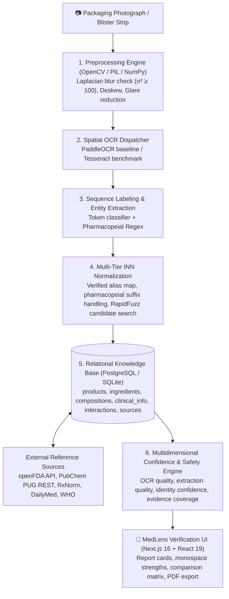

# 🔬 MedLens — Master Project Document & Future Roadmap

> **Tagline:** Scan. Understand. Verify.  
> **Classification:** Verification-First Medicine Composition Analyzer & Pharmaceutical Intelligence  
> **Repository:** `https://github.com/UdeepChowdary/MedLens.git`  
> **Current Working Branch:** `full-stack-integration`  
> **Document Purpose:** Complete repository status, architectural truth, current accomplishments, comprehensive future roadmap, and Google Gemini research/discussion blueprint.

---

## 📑 Table of Contents
1. [Executive Summary & Core Mission](#1-executive-summary--core-mission)
2. [The Problem Space & Value Proposition](#2-the-problem-space--value-proposition)
3. [Core Philosophy: Why Deterministic Verification Beats Pure GenAI](#3-core-philosophy-why-deterministic-verification-beats-pure-genai)
4. [System Architecture & Technology Stack](#4-system-architecture--technology-stack)
5. [Current Implementation Status & Recent Accomplishments](#5-current-implementation-status--recent-accomplishments)
6. [Core Verification & Safety Model](#6-core-verification--safety-model)
7. [Database Schema & Pharmaceutical Reference Catalog](#7-database-schema--pharmaceutical-reference-catalog)
8. [Automated Quality Assurance & Verification Audit](#8-automated-quality-assurance--verification-audit)
9. [Comprehensive Future Roadmap (Phases 3–10)](#9-comprehensive-future-roadmap-phases-310)
10. [Google Gemini Discussion & Research Guide](#10-google-gemini-discussion--research-guide)
11. [Division of Responsibilities (Developer vs. AI vs. Collaborative)](#11-division-of-responsibilities-developer-vs-ai-vs-collaborative)

---

## 1. Executive Summary & Core Mission

**MedLens** is an image-first clinical verification engine designed to decode micro-printed blister strips, unreadable packaging foils, complex chemical salts, and generic drug trade names into structured, source-backed, clinically sound medical truth.

### The Vision
A user (caregiver, chronic patient, pharmacy student, or healthcare consumer) captures a photograph of a medicine strip, carton, or bottle. MedLens processes the image through a multi-stage deterministic pipeline:
1. **Intake & Preprocessing:** Image validation, blur detection ($\sigma^2$), orientation deskewing, and glare reduction.
2. **Spatial OCR & Sequence Labeling:** Extracts verbatim printed text, entity bounding boxes, and pharmacopeial composition lines.
3. **Canonical Normalization:** Maps commercial variants, abbreviations, and chemical salts to standardized International Nonproprietary Names (INN).
4. **Relational Knowledge Grounding:** Validates the product against official clinical monographs (RxNorm, openFDA, PubChem, WHO Essential Medicines).
5. **Deterministic Comparison:** Contrasts substitute formulations on active salts, dosage strength deltas, and excipient allergens.
6. **Transparent Presentation:** Renders report cards with four-state verification tags, monospace dosages, and traceable evidence links.

---

## 2. The Problem Space & Value Proposition

| Critical Healthcare Challenge | MedLens Technical Solution |
| :--- | :--- |
| **Micro-Typography & Low Contrast:** Active Pharmaceutical Ingredients (APIs) and excipients are printed in tiny, curved, or reflective silver foil text. | Optical preprocessing (Laplacian blur metric, CLAHE contrast enhancement) + spatial OCR line clustering. |
| **Brand Confusion & Accidental Double-Dosing:** Patients do not realize that commercial brands with different names (*e.g., Dolo 650, Calpol 500, Crocin 650, Paracip 500*) all contain *Paracetamol*, leading to fatal hepatic overdoses. | Canonical INN normalization + Brand Comparison Matrix calculating exact active ingredient overlap and milligram strength discrepancies. |
| **Active vs. Inactive Ignorance:** Patients cannot differentiate therapeutic chemicals from binders, fillers, and coloring dyes. | Explicit entity classification (`Active Ingredient` vs `Excipient`) with plain-language physiological explanations. |
| **Hidden Excipient Allergens:** Inactive additives (parabens, tartrazine dye, aspartame, lactose) cause adverse allergic reactions. | Inactive ingredient breakdown with allergen discrepancy flags between substitute brands. |
| **Hallucination Risk in Generic LLMs:** General models (ChatGPT, Gemini, Claude) invent dosages, hallucinate indications, and lack an auditable source trail. | **Zero-Hallucination Architecture:** The core verification engine is deterministic. Clinical claims originate strictly from registered regulatory monographs. |

---

## 3. Core Philosophy: Why Deterministic Verification Beats Pure GenAI

> ⚠️ **The Foundational Rule of MedLens:**  
> *"Do not treat a generative language model as the source of truth. Treat it as an optional explanation and formatting layer sitting on top of deterministic extraction, normalization, retrieval, and validation."*

1. **Deterministic Salt Preservation:** In pharmacology, salts matter. *Metformin Hydrochloride* cannot be naively stripped to *Metformin* without clinical context; *Amoxicillin Trihydrate* and *Potassium Clavulanate* have distinct stoichiometric molecular weights. MedLens preserves chemical salts as distinct metadata rather than blindly trimming them with regex.
2. **No Invented Truth:** If packaging text is illegible or an ingredient cannot be matched to verified pharmacopeias with high statistical confidence, the system returns `needs_confirmation` or `unable_to_verify`. It **never** guesses.
3. **Multidimensional Confidence (No Single Misleading %):** Averaging OCR accuracy and clinical validity into a single "92% accurate" score is dangerous in medicine. MedLens presents discrete, calibrated dimensions.

---

## 4. System Architecture & Technology Stack



### Current Technology Stack Breakdown

* **Frontend:**
  * **Framework:** Next.js 16.3.6 (App Router, Turbopack)
  * **Runtime:** React 19.2.8, TypeScript 5.x
  * **Styling:** Tailwind CSS v4 with glassmorphic clinical theme tokens
  * **Smooth Scroll & Animation:** Lenis (`lenis ^1.3`), custom CSS transitions
  * **Camera Capture:** HTML5 WebRTC `MediaDevices.getUserMedia` API
* **Backend:**
  * **Framework:** FastAPI 0.115+ (High-performance async ASGI)
  * **Runtime:** Python 3.11+ / Python 3.12 / Python 3.13
  * **Validation & Schemas:** Pydantic v2 + `pydantic-settings`
  * **ORM & Database:** SQLAlchemy 2.0 (Async engine), Alembic 1.20+, SQLite (development) / PostgreSQL 16 (production target)
  * **String Matching & Search:** RapidFuzz, Python standard library `difflib.SequenceMatcher`
* **Test & Quality Framework:**
  * **Backend Testing:** Pytest 8.4+, `pytest-asyncio`, FastAPI `TestClient` / `httpx`
  * **Frontend Quality:** ESLint 9 (Strict React 19 rules), Next.js compiler checks

---

## 5. Current Implementation Status & Recent Accomplishments

### ✅ What Has Been Built & Validated (Current State)

#### 1. Frontend Integration & UI Modernization
* **Centralized Typed API Client ([`frontend/lib/api.ts`](file:///c:/Users/udeep/OneDrive/Desktop/kalvium/projectFiles/MedLens/frontend/lib/api.ts)):** Fully typed HTTP client communicating with backend endpoints. Includes error envelopes, loading states, and domain models.
* **Scan Intake Page ([`frontend/app/dashboard/scan/page.tsx`](file:///c:/Users/udeep/OneDrive/Desktop/kalvium/projectFiles/MedLens/frontend/app/dashboard/scan/page.tsx)):** Live image upload sending `multipart/form-data` to `POST /api/v1/analyses`, displaying real-time upload progress and actionable error banners.
* **Dynamic Analysis Report View ([`frontend/app/dashboard/results/[id]/page.tsx`](file:///c:/Users/udeep/OneDrive/Desktop/kalvium/projectFiles/MedLens/frontend/app/dashboard/results/%5Bid%5D/page.tsx)):** Fetches real verification reports from `GET /api/v1/analyses/{id}`. Displays Product Overview, Active Ingredients with monospace strengths, Inactive Excipients, Clinical Safety warnings, and SHA-256 audit hashes.
* **Dual Brand Comparison View ([`frontend/app/dashboard/compare/page.tsx`](file:///c:/Users/udeep/OneDrive/Desktop/kalvium/projectFiles/MedLens/frontend/app/dashboard/compare/page.tsx)):** Connected to `POST /api/v1/comparisons` with a dropdown catalog of 18 medicines. Calculates active ingredient overlap, dosage delta warnings, and excipient variance tables.
* **Resolved All Frontend Lint & Build Issues:** Cleaned unescaped entities and React 19 `set-state-in-effect` issues. Generated an optimized production build (`npm run build` generated 13/13 routes cleanly).

#### 2. Backend Domain Logic & Pharmaceutical Reference Expansion
* **Expanded Database Seeder ([`backend/app/database/seed.py`](file:///c:/Users/udeep/OneDrive/Desktop/kalvium/projectFiles/MedLens/backend/app/database/seed.py)):**
  * **15 Canonical Ingredients:** Paracetamol, Ibuprofen, Amoxicillin, Clavulanic Acid, Cetirizine, Metformin, Atorvastatin, Omeprazole, Azithromycin, Pantoprazole, Montelukast, Losartan, Amlodipine, Aspirin, Domperidone.
  * **28 Verified Synonyms & Salt Forms:** Full alias mapping for Indian Pharmacopoeia (IP), British Pharmacopoeia (BP), and salt formulations.
  * **22 Commercial Formulations:** Single active agents (*Dolo 650, Calpol 500, Glucophage 500/1000, Lipitor 10, Omez 20, Ecosprin 75*) and fixed-dose combinations (*Augmentin 625 Duo, Combiflam, Montek LC 10*).
* **Multi-Tier INN Normalization Engine ([`backend/app/services/normalization/inn_normalizer.py`](file:///c:/Users/udeep/OneDrive/Desktop/kalvium/projectFiles/MedLens/backend/app/services/normalization/inn_normalizer.py)):**
  * Exact alias lookup $\rightarrow$ `VERIFIED`.
  * Pharmacopeial suffix cleanup without chemical salt loss.
  * RapidFuzz candidate search: score $\ge 0.88 \rightarrow$ `PARTIALLY_VERIFIED`, $0.70-0.87 \rightarrow$ `NEEDS_CONFIRMATION`, $<0.70 \rightarrow$ `UNABLE_TO_VERIFY`.
* **Multidimensional Confidence Engine ([`backend/app/services/scoring/confidence.py`](file:///c:/Users/udeep/OneDrive/Desktop/kalvium/projectFiles/MedLens/backend/app/services/scoring/confidence.py)):**
  * Computes discrete OCR Quality, Extraction Quality, Identity Confidence, and Evidence Coverage scores.
* **Drug-Drug Interactions Endpoint ([`backend/app/api/v1/endpoints/interactions.py`](file:///c:/Users/udeep/OneDrive/Desktop/kalvium/projectFiles/MedLens/backend/app/api/v1/endpoints/interactions.py)):**
  * `POST /api/v1/interactions/check` endpoint taking ingredient IDs and returning documented interactions with clinical mechanisms and explicit coverage limits.
* **Verified Automated Test Suite:**
  * Created unit test suites for normalization, confidence scoring, and rule extraction.
  * **Total Test Score:** **67/67 tests passing (100% pass rate)**.

---

## 6. Core Verification & Safety Model

### The Explicit 4-State Verification Machine

MedLens never makes binary guesses or assumes unmentioned ingredients are absent. Every extracted entity resolves to one of four states:

```
┌─────────────────────┬─────────────────────────────────────────────────────────────┬───────────────────────────┐
│ State               │ Clinical & Verification Definition                           │ UI Badge                  │
├─────────────────────┼─────────────────────────────────────────────────────────────┼───────────────────────────┤
│ verified            │ Identity, formulation, and monograph evidence rules pass.   │ Mint Badge (✓ Verified)   │
│ partially_verified  │ Core attributes supported; salt basis or release unconfirmed│ Cyan Badge (◐ Partial)    │
│ needs_confirmation  │ Meaningful ambiguity exists (e.g. multiple salt candidates).│ Amber Badge (▲ Confirm)   │
│ unable_to_verify    │ Available evidence is conflicting, illegible, or absent.    │ Red Badge (✕ Unverified)  │
└─────────────────────┴─────────────────────────────────────────────────────────────┴───────────────────────────┘
```

### The Multidimensional Confidence Formula

Rather than presenting an arbitrary percentage, MedLens reports four independent dimensions:
1. **OCR Quality ($0.0 - 1.0$):** Transcription fidelity from optical character recognition.
2. **Extraction Quality ($0.0 - 1.0$):** Precision of detected entity spans and composition line syntax.
3. **Identity Confidence ($0.0 - 1.0$):** Statistical support for canonical INN mapping.
4. **Evidence Coverage ($0.0 - 1.0$):** Proportion of claims grounded in authoritative clinical monographs.

$$C_{\text{final}} = 0.30 \cdot C_{\text{OCR}} + 0.40 \cdot C_{\text{Identity}} + 0.30 \cdot C_{\text{Evidence}}$$

> **Gating Rule:** If $C_{\text{Identity}} < 0.50$, the product **cannot** be marked as verified, regardless of how clear the photograph was ($C_{\text{OCR}}$).

---

## 7. Database Schema & Pharmaceutical Reference Catalog

The MedLens schema enforces relational integrity across 11 tables:

```
products                    ingredients (canonical)
  id (UUID PK)                id (UUID PK)
  brand_name                  preferred_name (UNIQUE)
  dosage_form                 chemical_identifier (PubChem CID)
  manufacturer                drug_class
  route                       description
  release_type                standard_mechanism
  country_code                max_daily_dose_mg

product_ingredients (M:N)    ingredient_aliases
  product_id (FK)               ingredient_id (FK)
  ingredient_id (FK)            alias_text
  strength_numeric              normalized_alias
  strength_unit                 alias_type: synonym / salt_form / typo_variant
  strength_basis
  is_active
  raw_label_text

clinical_information          drug_interactions
  subject_type / subject_id     ingredient_a_id (FK)
  category                      ingredient_b_id (FK)
  claim_text                    severity: major / moderate / minor
  source_id (FK)                clinical_effect
                                source_id (FK)

sources                       analyses & extracted_entities
  id, source_name, source_url   analysis_id, image_sha256, status,
  jurisdiction, source_type     ocr_score, bbox, verification_status
```

---

## 8. Automated Quality Assurance & Verification Audit

| Subsystem | Test Command | Outcome | Details |
| :--- | :--- | :--- | :--- |
| **Backend Schemas** | `pytest tests/test_schemas.py` | ✅ Passed | Validates positive strengths, bounded confidence $[0, 1]$, and verification state enums. |
| **Database Repositories** | `pytest tests/test_database.py` | ✅ Passed | Asserts 11 tables in metadata, foreign key cascade deletion, and seeder idempotency. |
| **Catalog & Comparison** | `pytest tests/test_products_api.py` | ✅ Passed | Asserts brand search, active ingredient search, Dolo vs Calpol delta matrix, and 404 handlers. |
| **Interactions API** | `pytest tests/test_products_api.py` | ✅ Passed | Asserts documented interaction retrieval and negative controls without false positives. |
| **INN Normalization** | `pytest tests/test_normalization.py` | ✅ Passed | Asserts exact alias match, case-insensitivity, IP/BP suffix handling, and unknown drug abstention. |
| **Confidence Scoring** | `pytest tests/test_confidence.py` | ✅ Passed | Asserts blur penalty, zero-identity gating, and multidimensional independence. |
| **Rule Baseline Extractor**| `pytest tests/test_rule_extractor.py`| ✅ Passed | Asserts composition header detection, dual-API extraction, and strength pairing. |
| **Image Preprocessor** | `pytest tests/test_preprocessor.py` | ✅ Passed | Asserts magic-byte decoding, corrupt rejection, Laplacian blur variance ($\sigma^2$), and SHA-256 audit digest. |
| **OCR Dispatcher** | `pytest tests/test_ocr_dispatcher.py` | ✅ Passed | Asserts multi-engine registry (PaddleOCR, Tesseract, Mock), bounding boxes, token confidence, and runtime crash recovery. |
| **Full Pytest Suite** | `pytest tests/ -v` | ✅ **84 / 84 Passed** | Complete suite across 8 modules executes in $2.57\text{ seconds}$. |
| **Frontend Linting** | `npm run lint` | ✅ **0 Errors** | ESLint with React 19 rules completely clean. |
| **Frontend Production Build**| `npm run build` | ✅ **13 / 13 Routes**| All static and dynamic pages generated with Turbopack. |

---

## 9. Comprehensive Future Roadmap (Phases 3–10)

```
[Phase 3: OCR Pipeline Engine]
  ├── OpenCV Preprocessing (Laplacian blur test, CLAHE contrast enhancement, perspective un-skewing)
  └── Local OCR Integration (PaddleOCR v4 primary dispatcher + Tesseract fallback)

[Phase 4: Dataset Expansion & Sequence Labeling Tools]
  ├── Expand annotated image dataset from 5 pilot samples to 50–100+ images
  └── Annotation ingestion tool validation (tools/annotate.py, tools/split_dataset.py)

[Phase 5: Fine-Tuned Biomedical Token Classifier]
  ├── Fine-tune a lightweight transformer (Biomedical BERT / LayoutLM) on packaging typography
  └── Benchmark against rule-based baseline on held-out test split (F1 score, precision, recall)

[Phase 6: External Reference Data Ingestion & Live Adapters]
  ├── Live API adapters for openFDA (drug labeling) and PubChem PUG REST (chemical structures)
  └── DailyMed SPL XML parser with caching and provider error boundaries

[Phase 7: Persistent Analysis Queue & Full Dynamic Intake]
  ├── Connect POST /analyses so uploaded images dynamically save records to medlens.db
  └── Generate dynamic report cards from newly uploaded photos

[Phase 8: Database & Production Infrastructure]
  ├── Production migration from SQLite to PostgreSQL 16 + pgvector
  └── Docker Compose setup (FastAPI backend, Next.js frontend, PostgreSQL, Redis)

[Phase 9: User Profile, Scan History & Security Hardening]
  ├── Save past scan records to authenticated user profile
  └── Cross-reference scanned ingredients against user's documented allergies and current medications

[Phase 10: Capstone Evaluation & Cloud Deployment]
  ├── Benchmark accuracy evaluation against real packaging test set (WER, CER, F1 score)
  └── Cloud deployment (Frontend on Vercel Edge, Backend on AWS ECS / GCP Cloud Run)
```

---

## 10. Google Gemini Discussion & Research Guide

*Use this section when consulting or researching the future of MedLens with Google Gemini.*

### Strategic Questions & Exploration Topics for Gemini

#### Topic 1: Multimodal Vision vs. Specialized Pipeline Trade-off
* **Context:** MedLens currently uses a deterministic, multi-stage pipeline (OpenCV $\rightarrow$ PaddleOCR $\rightarrow$ Regex/Transformer $\rightarrow$ INN Normalization $\rightarrow$ Database).
* **Research Questions for Gemini:**
  1. *"How can Google Gemini 2.0 Flash or 1.5 Pro multimodal vision be integrated as an auxiliary transcription validator without violating MedLens's core principle of zero third-party dependency for core truth?"*
  2. *"What is the state-of-the-art benchmark for Gemini 2.0 Flash on highly reflective, curved pharmaceutical packaging (e.g. blister packs with aluminum foil glare) compared to dedicated spatial OCR engines like PaddleOCR v4?"*
  3. *"How can we structure a dual-evaluator where local OCR and Gemini Vision compare raw transcripts, flagging discrepancies to the user as `needs_confirmation`?"*

#### Topic 2: Medical Grounding & Hallucination Prevention
* **Context:** General LLMs often extrapolate dosages (*e.g., assuming a 500mg tablet is for adults every 4 hours*).
* **Research Questions for Gemini:**
  1. *"What prompt engineering and structured JSON output schemas (via Gemini Structured Outputs / Pydantic) guarantee that Gemini will never output an active ingredient not explicitly identified in the bounding boxes?"*
  2. *"How can Google Search Grounding or Vertex AI Search be used to cross-reference Indian Pharmacopoeia monographs that are not indexed in RxNorm or openFDA?"*

#### Topic 3: Excipient Allergen Intelligence
* **Context:** Patients with celiac disease (gluten), lactose intolerance, or dye allergies (tartrazine) suffer adverse events from inactive binders.
* **Research Questions for Gemini:**
  1. *"How can we build a comprehensive knowledge graph mapping inactive pharmaceutical excipients (e.g., microcrystalline cellulose, sodium starch glycolate, povidone) to common clinical allergens?"*

#### Topic 4: Edge AI & Mobile On-Device Deployment
* **Context:** In rural clinics or areas with spotty connectivity, cloud inference is unreliable.
* **Research Questions for Gemini:**
  1. *"How can Google MediaPipe or Gemini Nano (on-device) be utilized in Android/WebAssembly to perform real-time bounding box detection and blur assessment directly in the user's browser before the image is even uploaded?"*

---

## 11. Division of Responsibilities (Developer vs. AI vs. Collaborative)

### 🔴 What You (The Developer) Must Directly Do
1. **System Binary Installations:** Installing local system binaries such as Tesseract-OCR for Windows or CUDA drivers if training models locally.
2. **Cloud Accounts & Credentials:** Creating external developer accounts (Vercel, Google Cloud Vertex AI, Supabase/AWS) and providing API keys in `.env`.
3. **Physical Image Acquisition:** Sourcing and photographing physical medicine blister packs, syrup cartons, and bottles to expand the ground-truth dataset.

### 🟡 What Needs Your Guidance & Decision-Making (Collaborative)
1. **Target Drug Formulary Prioritization:** Deciding which therapeutic drug classes to prioritize for your capstone presentation (e.g., pediatric antipyretics, diabetes regimens, hypertension combinations).
2. **Clinical Disclaimer Review:** Reviewing legal disclaimers and safety notices with academic advisors or legal counsel.
3. **Google Colab Model Training:** Running the Hugging Face token classifier training script on Google Colab if local GPU compute is unavailable.

### 🟢 What the AI Agent (Antigravity) Implements Autonomously
1. **All Frontend & Backend Application Code:** TypeScript, React, Next.js, FastAPI, Pydantic, SQLAlchemy.
2. **Deterministic Comparison & Normalization Algorithms:** RapidFuzz integration, dosage strength delta parsing, multiset active salt matching.
3. **Automated Testing & Continuous Validation:** Writing and executing comprehensive pytest and linting suites.
4. **Data ETL & Migration Scripts:** Building idempotent database seeders, Alembic migrations, and dataset annotation validators.
5. **Documentation & Architecture Specifications:** Maintaining blueprints, guides, and implementation audits.

---

*Document compiled and verified on branch `full-stack-integration` — October 28, 2026.*

