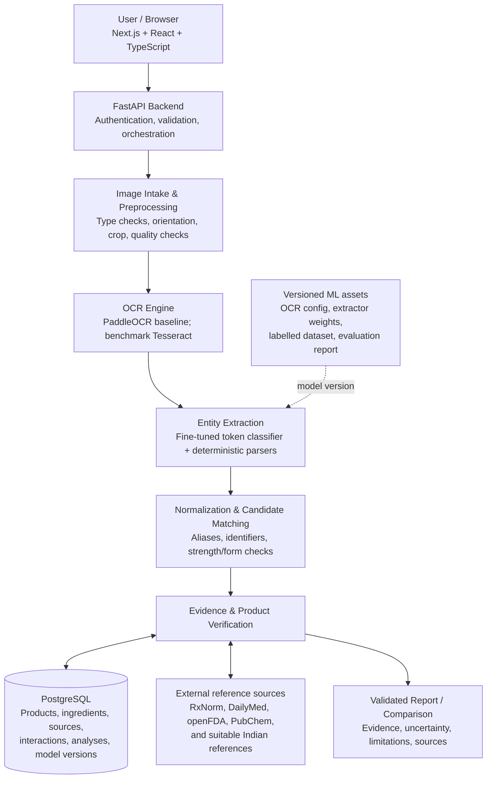

# MEDLENS

## CAPSTONE IMPLEMENTATION BLUEPRINT

_A build specification for Antigravity IDE / agy_

**Version 1.0** | 13 October 2026 | Prepared for repository implementation

**SCAN. UNDERSTAND. VERIFY.**

> Build a verification-first medicine-label analysis system using local
> ML, structured pharmaceutical data, auditable evidence, and
> deterministic comparison logic.

_Architecture overview: see Section 03 for the target architecture diagram._

> **DOCUMENT STATUS**
>
> This is a target-state implementation specification, not a claim that all listed services, datasets, or features already exist. The coding agent must inspect the current repository before making changes and implement the plan incrementally.

# Document map

| **Section** | **Contents**                                                 |
|-------------|--------------------------------------------------------------|
| 01          | Purpose, project boundaries, and success criteria            |
| 02          | Operating instructions for Antigravity / agy                 |
| 03          | Target architecture and technology decisions                 |
| 04          | Database design and pharmaceutical data strategy             |
| 05          | Image intake and OCR pipeline                                |
| 06          | Custom ML extraction model and evaluation                    |
| 07          | Ingredient normalization and product verification            |
| 08          | Evidence retrieval, reports, and confidence                  |
| 09          | Medicine comparison and interaction checking                 |
| 10          | API contracts and frontend integration                       |
| 11          | Safety, privacy, security, and limitations                   |
| 12          | Testing, benchmarking, and acceptance criteria               |
| 13          | Repository structure and delivery roadmap                    |
| 14          | Definition of done, agent rules, and starting prompt         |
| Appendix    | Recommended reference resources and implementation checklist |

## How this document should be used

Keep this PDF at the repository root or in docs/ so it can be attached
to Antigravity IDE / agy as durable project context. It defines the
intended product, architectural boundaries, staged plan, and acceptance
criteria. It does not override the need to inspect the actual code,
package scripts, environment variables, existing styling, or current
test results.

> **RECOMMENDED WORKING MODE**
>
> Ask the coding agent to read this specification, inspect the current repository, summarize what is already implemented versus planned, and propose the smallest next milestone. Do not ask it to generate the entire backend, train a model, and redesign the frontend in one pass.

## Contents are target requirements, not existing functionality

Unless code, tests, migrations, or reproducible demonstrations prove a
component exists, treat it as planned. The README and previous project
brief describe the intended pipeline; each implementation step must
verify current reality before modifying the codebase.

# 01. Project purpose and boundaries

## 1.1 Product definition

MedLens is an ML-powered medicine-label understanding, verification, and
comparison system. A user uploads or captures a photograph of medicine
packaging. The application extracts text, identifies candidate
ingredients and strengths, normalizes names against a controlled
knowledge base, verifies the candidate against source-backed product
information, and returns a structured report with sources and explicit
uncertainty.

> **CORE PRODUCT PRINCIPLE**
>
> MedLens is not a generic medicine chatbot. It is a verification-first pipeline in which OCR and ML extract information, structured reference data supports identification, deterministic rules check key attributes, and the UI explains what was and was not verified.

## 1.2 Problem being solved

Medicine packaging can include small text, abbreviations, multiple
active ingredients, strengths, chemical forms, and warnings. A general
user may need to search each item separately. MedLens reduces this
effort by transforming a label image into organized information while
preserving the relationship between every finding and its supporting
evidence.

## 1.3 In-scope capabilities

- Image upload and camera capture from the existing web interface.

- Local or self-hosted OCR with image preprocessing and quality checks.

- ML-based extraction of ingredient names, strengths, concentrations,
  dosage forms, and relevant fields.

- Ingredient normalization through verified aliases, identifiers,
  controlled matching, and explicit ambiguity handling.

- Product and composition verification against suitable reference
  sources and the local database.

- Structured, source-backed medicine reports with confidence dimensions
  and limitations.

- Deterministic composition comparison between two identified medicines.

- Source-backed interaction lookup with clear coverage limitations.

- Correction flow, report history where appropriate, export, evaluation,
  tests, and deployment documentation.

## 1.4 Out of scope for the initial release

- Diagnosis, treatment recommendations, prescription generation, dose
  adjustment, or personalized clinical decision-making.

- Claims that two products are interchangeable unless suitable
  product-specific authoritative evidence supports that conclusion.

- Claims of exhaustive worldwide medicine coverage or a complete
  interaction-free status.

- Training a large foundation model from scratch.

- Mandatory dependency on Gemini, OpenAI, Claude, or another hosted
  generative-AI inference API.

- Silent inference from missing or ambiguous information.

## 1.5 Success criteria

A successful capstone must be more than a visually complete page. It
must demonstrate an end-to-end scan workflow, a custom or fine-tuned
extraction model, a normalized evidence-backed database, defensible
comparison logic, testable abstention behavior, measurable ML results,
and clear documentation of limitations.

# 02. Operating instructions for Antigravity / agy

## 2.1 Expected behavior from the coding agent

- Inspect the existing repository before proposing changes. Read its
  README, package manifests, routes, components, styles, scripts,
  environment-variable examples, and tests.

- Distinguish completed code from README claims, mock data, placeholder
  APIs, TODOs, and planned features.

- Preserve the existing Next.js UI, branding, and working behavior
  unless a specific change is required and approved by the task.

- Implement one coherent milestone at a time. Prefer small, reviewable
  changes over wholesale rewrites.

- Before adding a dependency, explain why it is needed and check whether
  an existing dependency already solves the problem.

- Never commit secrets, real user medicine images, unlicensed reference
  data, model weights without permission, or credentials.

- Never fabricate medicine facts, source URLs, successful verification,
  evaluation metrics, or test outcomes.

- Add tests for new normalization, matching, comparison, and safety
  logic. Run existing tests and relevant build/lint commands.

- If a source/API is unavailable, create a clearly marked adapter
  boundary and report the blocker; do not simulate live verification as
  successful.

- At the end of each task, report files changed, behavior implemented,
  tests run and results, known limitations, and the next recommended
  step.

## 2.2 Implementation order is binding

1\. Repository audit and implementation inventory

2\. Backend skeleton and configuration

3\. Database schema and migrations

4\. Image intake + OCR baseline

5\. Extraction data format + rule-based baseline

6\. Label dataset + fine-tuned extraction model

7\. Normalization + product verification

8\. Evidence-backed report

9\. Comparison + interaction retrieval

10\. Frontend integration + security hardening

11\. Evaluation, deployment, documentation

## 2.3 Do not do these things

- Do not replace the whole frontend to match a generic template.

- Do not build every feature in one giant prompt or one unreviewed
  commit.

- Do not store the whole medicine knowledge base as loosely related
  Firestore documents solely for setup convenience.

- Do not use fuzzy name similarity as proof of ingredient identity.

- Do not report a single weighted score as “medical accuracy”.

- Do not infer “no interaction”, “safe”, or “equivalent” from missing
  data.

- Do not call a product verified unless the defined matching and
  evidence rules pass.

- Do not add a generative AI service as a hidden fallback for failed OCR
  or uncertain composition.

## 2.4 Repository audit deliverable

The first coding-agent task should produce a short audit document, not
immediately modify application behavior. It should list the current
frontend stack, main routes/components, working flows, existing backend
status, environment variables, test/build commands, data/storage
choices, unimplemented claims, and a proposed implementation sequence
mapped to this blueprint.

# 03. Target architecture and technology decisions

## 3.1 Preferred stack

| **Layer**           | **Preferred choice**                                           | **Why / boundary**                                                                               |
|---------------------|----------------------------------------------------------------|--------------------------------------------------------------------------------------------------|
| Web UI              | Existing Next.js + React + TypeScript                          | Keep the working interface; add typed API clients and feature screens incrementally.             |
| Backend API         | Python + FastAPI                                               | Orchestrates image processing, ML inference, reference adapters, and business rules.             |
| Relational database | PostgreSQL                                                     | Best fit for products, ingredients, aliases, strengths, evidence, and interaction relationships. |
| Database hosting    | Managed PostgreSQL (for example, Supabase or another provider) | Choose based on budget, deployment environment, backup, networking, and operational fit.         |
| Auth                | Firebase Authentication is optional                            | Use only if it simplifies the existing frontend; backend must verify identity tokens.            |
| Image storage       | Firebase Storage or equivalent object storage, optional        | Keep uploads private, validate them, and apply a retention policy.                               |
| Preprocessing       | OpenCV + standard image utilities                              | Orientation, contrast, deskew, crop, blur/quality checks.                                        |
| OCR                 | PaddleOCR baseline; Tesseract benchmark                        | Select based on measured performance on the MedLens image set.                                   |
| ML extraction       | PyTorch + Hugging Face Transformers                            | Fine-tune a token-classification model for medicine-label entities.                              |
| Normalization       | Python rules + verified aliases + RapidFuzz candidate search   | Fuzzy matching produces candidates, never standalone proof.                                      |
| Search              | SQL first; pgvector only if justified                          | Exact identifiers and structured queries take precedence for medicine identity.                  |
| Testing             | pytest + API integration tests + frontend tests                | Test components and the full upload-to-report path.                                              |
| Deployment          | Vercel frontend + Python backend host + managed PostgreSQL     | Keep model runtime and resource limits in mind when selecting a host.                            |

## 3.2 Firebase decision

Use Firebase where it provides a concrete convenience, such as
authentication or image storage. PostgreSQL remains the primary
pharmaceutical knowledge database. Firestore can support user-oriented
document data if a real use case warrants it, but it should not become a
duplicate source of truth for products and ingredients. Firebase SQL
Connect is an optional alternative if the team specifically wants a
Firebase-managed relational workflow; because the ML pipeline runs in
Python, compare its integration overhead against direct PostgreSQL
access before choosing it.

## 3.3 Architectural separation

| **Data category**  | **Meaning**                                                                | **Where it belongs**                                               |
|--------------------|----------------------------------------------------------------------------|--------------------------------------------------------------------|
| Raw extraction     | What OCR and the ML model read from this specific image                    | Analysis/job record; keep provenance and model version.            |
| Canonical identity | Normalized ingredient/product identifiers and verified aliases             | Relational reference tables with constraints.                      |
| Evidence / claims  | Source-backed use, precaution, adverse-effect, and interaction information | Clinical-information / evidence records linked to source metadata. |
| User-facing result | Rendered conclusion with verified and unresolved fields                    | Structured API response; optionally saved in analysis history.     |
| Model artifacts    | Weights, tokenizer, training config, evaluation data/metrics               | Versioned ML artifacts, not ordinary clinical reference tables.    |

## 3.4 External-service resilience

Reference APIs may be unavailable, rate-limited, incomplete, or changed.
Put each source behind a small adapter interface. Cache only information
that the source permits us to retain. Return an explicit
partial/unavailable state when retrieval fails. The application must
never silently replace missing external evidence with invented content.

# 04. Database design and pharmaceutical data strategy

## 4.1 Core relational entities

| **Table**            | **Purpose**                                    | **Key fields / constraints**                                                                                                                                              |
|----------------------|------------------------------------------------|---------------------------------------------------------------------------------------------------------------------------------------------------------------------------|
| products             | A product or presentation in a specific market | product_id; brand_name; manufacturer; country/jurisdiction; dosage_form; route; release_type; status; source_id. Keep external identifiers unique within their namespace. |
| ingredients          | Canonical ingredient or defined chemical form  | ingredient_id; preferred_name; ingredient_type; chemical_identifier and namespace; description; normalization_status.                                                     |
| product_ingredients  | Many-to-many composition relationship          | product_id + ingredient_id + product-specific formulation row; strength_value; strength_unit; strength_basis; source_id; declared_role.                                   |
| ingredient_aliases   | Verified alternative names                     | alias_id; ingredient_id; alias_text; normalized_alias; language; source_id; approval status. Add uniqueness only where semantically safe.                                 |
| clinical_information | Source-backed clinical facts or label sections | record_id; subject_type/id; category; text/value; jurisdiction; applicability; source_id; version/effective date.                                                         |
| drug_interactions    | Documented ingredient interaction records      | ingredient_a_id; ingredient_b_id; description; severity only if supported; evidence_source_id; source date; review status.                                                |
| sources              | Evidence provenance and source metadata        | source_id; source_name; source_type; URL/identifier; jurisdiction; retrieval timestamp; source version; license/retention notes.                                          |
| analyses             | One upload/analysis attempt and final state    | analysis_id; user_id optional; timestamps; status; image object reference if retained; model versions; failure/abstention reason; retention status.                       |
| extracted_entities   | Field-level output from OCR/extraction         | analysis_id; entity_type; raw_text; normalized_candidate; bbox; OCR score if available; extractor score if calibrated; verification status.                               |
| analysis_sources     | Sources actually used by an analysis           | analysis_id; source_id; retrieved record identifier; query/match metadata; retrieval status.                                                                              |
| model_versions       | Reproducibility metadata                       | model_id; version; artifact location; hash; dataset version; training configuration; evaluation summary; deployment status.                                               |

## 4.2 Database engineering rules

- Use migrations (for example, Alembic) rather than manually editing
  production tables.

- Use stable internal UUIDs or another consistent primary-key strategy;
  keep provider-specific external identifiers separately namespaced.

- Represent ingredient strength as numeric value + unit + basis, not as
  an unparsed string only.

- Preserve original label text alongside normalized values so decisions
  can be audited.

- Use foreign keys for canonical relationships and explicit uniqueness
  constraints where correct.

- Index normalized names, external identifiers, product-to-ingredient
  joins, and commonly queried source records.

- Store source jurisdiction, retrieval time, and relevant
  version/effective date where available.

- Do not mix product-specific labeling claims with general ingredient
  facts without marking their applicability.

- Use transactions when importing products and their composition to
  avoid partially imported records.

- Keep raw images outside the relational database; store a private
  object reference only when retention is necessary.

## 4.3 Source strategy

| **Source family**                    | **Good starting use**                                                                     | **Cautions**                                                                                        |
|--------------------------------------|-------------------------------------------------------------------------------------------|-----------------------------------------------------------------------------------------------------|
| RxNorm                               | Normalized drug names, identifiers, ingredient/product relationships for covered records. | Coverage is not a complete catalogue of Indian brands. Validate endpoint behaviour and identifiers. |
| DailyMed                             | Available product labeling and detailed label sections.                                   | A label is not a universal fact sheet for every country's product; capture source and jurisdiction. |
| openFDA                              | Structured drug-label records and fields such as warnings or indications where present.   | Records vary in completeness; absence of a section is not evidence that a risk does not exist.      |
| PubChem                              | Chemical identity, identifiers, and chemical properties.                                  | Not a standalone clinical source for indications, safety, or interchangeability.                    |
| Indian official/manufacturer sources | Indian market product details and local context where reliable and accessible.            | Check authority, currentness, reuse terms, and whether a page applies to the exact product.         |
| MedLens curated records              | Reviewed mappings, test fixtures, and harmonized application schema.                      | Every imported claim must preserve provenance; maintain correction and update processes.            |

## 4.4 Data ingestion approach

> **1.** Define an adapter interface for each reference provider:
> search, fetch, normalize, map fields, and return a typed result with
> source metadata.
>
> **2.** Build import scripts that are safe to rerun and idempotent.
> Never duplicate a product on each sync.
>
> **3.** Validate imported data against schema constraints and keep
> import error logs.
>
> **4.** Record retrieval date, source identifier, applicable
> jurisdiction, and any known license/retention restrictions.
>
> **5.** Create a small curated development catalogue first. Expand only
> after matching and source-quality rules are tested.

> **DATA QUALITY RULE**
>
> A source API response is evidence to be evaluated, not automatic truth for every field. If sources conflict or the product/jurisdiction cannot be established, preserve the ambiguity and make it visible.

# 05. Image intake and OCR pipeline

## 5.1 Image intake contract

Accept common raster formats supported by the application, with a
configured maximum upload size and decoded pixel limit. Validate the
real file content rather than trusting the filename or browser MIME
declaration. Reject unsupported, corrupted, or excessively large files
with a clear error. Strip unnecessary metadata where practical.

## 5.2 Preprocessing sequence

Upload

-\> validate type / size / decode

-\> correct orientation

-\> assess blur, glare, crop, and resolution

-\> convert or normalize colour representation

-\> deskew / perspective-correct when useful

-\> generate a small set of preprocessing candidates

-\> OCR each suitable candidate

-\> select/merge results using measured quality rules

-\> preserve text, token boxes, engine/version, and diagnostics

Do not add every possible image transformation without measurement.
Excessive thresholding can erase thin print or decimal points. Keep the
original temporary image for the current job as required, generate only
useful candidate variants, and record the selected preprocessing
configuration for debugging.

## 5.3 OCR engine strategy

| **Candidate** | **Role**                                                           | **Decision rule**                                                                                            |
|---------------|--------------------------------------------------------------------|--------------------------------------------------------------------------------------------------------------|
| PaddleOCR     | Primary experiment for local detection and recognition.            | Benchmark on the same MedLens image set; check model downloads, runtime, supported languages, and licensing. |
| Tesseract     | Independent baseline and potential low-resource fallback.          | Retain if it performs acceptably on target labels or helps identify OCR failure cases.                       |
| Cloud OCR     | Optional benchmark or future fallback, not a mandatory dependency. | Use only after privacy, cost, network, terms, and no-API-key goals are reviewed.                             |

## 5.4 OCR output format

{

"engine": "paddleocr", "engine_version": "\<pinned-version\>", "text":
"...",

"regions": \[{"text": "Example Ingredient 500 mg", "bbox": \[120, 240,
340, 275\], "confidence": 0.94}\],

"quality_flags": \["small_text"\], "preprocessing_profile":
"deskew_contrast_v1"

}

The values above are illustrative. Store coordinates in one documented
coordinate system and ensure confidence meaning matches the selected
engine. A raw OCR confidence is not a probability that the medicine
identity or the final clinical report is correct.

## 5.5 Failure and abstention behavior

- If image quality is too poor, ask for a clearer photograph rather than
  producing a confident report.

- If no composition area is found, show extracted text and offer manual
  correction or a rescan.

- If OCR engines disagree on ingredient or strength text, preserve the
  alternatives and flag the field.

- Never silently correct a clinically meaningful token without recording
  the original text and the basis for correction.

# 06. Custom ML extraction model and evaluation

## 6.1 ML objective

Build a domain-specific model that extracts structured entities from OCR
text taken from medicine labels. The model should complement
deterministic parsers and a verified ingredient dictionary; it should
not replace product verification or clinical sources.

## 6.2 Entity schema

| **Entity label**   | **Examples / interpretation**                                     |
|--------------------|-------------------------------------------------------------------|
| BRAND              | Brand/product wording printed on the package.                     |
| PRODUCT_NAME       | Named product or generic product wording, if present.             |
| INGREDIENT         | Ingredient name in the composition.                               |
| SALT_FORM          | Explicitly stated chemical/salt form; preserve it until verified. |
| STRENGTH           | Numeric strength with its displayed unit.                         |
| CONCENTRATION      | Concentration such as a mass per volume.                          |
| STRENGTH_BASIS     | Per tablet, per capsule, per 5 mL, per mL, per actuation, etc.    |
| DOSAGE_FORM        | Tablet, capsule, syrup, cream, injection, etc.                    |
| ROUTE              | Route when explicitly stated.                                     |
| RELEASE_TYPE       | Immediate/extended/delayed release only when text supports it.    |
| COMPOSITION_HEADER | Context such as “Each tablet contains”.                           |

Adjust the final label set after inspecting sample images; keep only
labels annotators can consistently identify from the OCR text.

## 6.3 Model approach

> **1.** Build a rule-based baseline using composition headings, unit
> patterns, and a known ingredient dictionary.
>
> **2.** Evaluate a pretrained clinical NER model such as Med7 only as a
> baseline candidate; its original clinical-note domain does not prove
> performance on medicine packaging.
>
> **3.** Fine-tune a modest pretrained transformer for token
> classification on annotated medicine-label OCR text.
>
> **4.** Keep deterministic parsers for strength and unit normalization,
> and have the model identify candidate spans.
>
> **5.** Version the model, tokenizer, label map, training
> configuration, dataset split, and evaluation results.

## 6.4 Dataset plan

Begin with 100-200 carefully annotated images to validate the pipeline,
then grow toward several hundred or around 1,000 diverse images as
resources allow. These are planning ranges, not guarantees; diversity
and annotation quality matter more than count alone.

- Use only permitted images; exclude private or identifying data from
  public datasets.

- Cover strips, boxes, bottles, syrups, multiple ingredients, tiny text,
  glare, blur, and rotation.

- Annotate transcription and entities; link each annotation to its image
  and version.

- Split by product/manufacturer where practical and freeze a held-out
  test set to reduce leakage.

- Record source/permissions, annotation policy, language, dataset/model
  versions, seeds, dependencies, artifact hashes, and known gaps.

## 6.5 Evaluation protocol

| **Metric**                        | **What it tells us**                                                          | **Important note**                                             |
|-----------------------------------|-------------------------------------------------------------------------------|----------------------------------------------------------------|
| OCR CER / WER                     | Character- and word-level transcription error rates.                          | Report overall and on difficult image subsets.                 |
| Entity precision / recall / F1    | How well each extracted entity span matches ground truth.                     | Report per entity label and macro/overall values.              |
| Exact ingredient / strength match | Whether canonical ingredient and strength value, unit, and basis are correct. | A wrong unit or basis is an error; false matches are critical. |
| Abstention / review rate          | How often the system asks for confirmation instead of auto-accepting.         | Measure correctness among accepted cases too.                  |

# 07. Ingredient normalization and product verification

## 7.1 Matching pipeline

Raw extracted span

-\> safe text cleanup

-\> exact normalized-name / alias lookup

-\> candidate retrieval (optional fuzzy matching)

-\> chemical/product identifier lookup

-\> strength + unit + basis validation

-\> dosage-form / route / release checks

-\> source-backed product consistency check

-\> verification state or user confirmation

## 7.2 Matching hierarchy

| **Priority** | **Method**                                | **Permitted conclusion**                                                       |
|--------------|-------------------------------------------|--------------------------------------------------------------------------------|
| 1            | Exact identifier within a known namespace | Strong identity evidence only if identifier type and record mapping are valid. |
| 2            | Exact verified canonical name or alias    | Candidate ingredient identity; check formulation/product context when needed.  |
| 3            | Controlled normalized text match          | Candidate match; preserve the raw text and normalization rule.                 |
| 4            | Fuzzy string / edit-distance search       | Candidate suggestions only. Never auto-verify solely on similarity.            |
| 5            | Manual confirmation                       | Useful for resolving ambiguity; re-run all validation after correction.        |

## 7.3 Salt forms and active moieties

> **NON-NEGOTIABLE NORMALIZATION RULE**
>
> Do not universally strip salt names or merge chemical forms based on string rules alone. Store explicit, source-backed relationships. Preserve the label form, normalized identity, and active-moiety relationship as separate fields when applicable.

Some forms can have meaningful differences in identity, strength
expression, formulation, or clinical context. A relationship should be
applied only when the reference data support it. When a valid
relationship cannot be established, retain the original text and mark
the normalization unresolved.

## 7.4 Strength normalization

Represent strength as a numeric value, unit, and basis. Parse
concentration separately from per-unit strength. Preserve the displayed
string as well as any normalized value. Do not convert between different
dose bases unless the conversion is dimensionally correct and the
product context establishes that it is appropriate.

## 7.5 Verification states

| **State**          | **Definition**                                                    | **UI behaviour**                                                                          |
|--------------------|-------------------------------------------------------------------|-------------------------------------------------------------------------------------------|
| verified           | Required identity fields meet evidence and consistency rules.     | Show matched fields, sources, jurisdiction, and what verification covers.                 |
| partially_verified | Some fields are supported; others remain unknown or inconsistent. | Separate verified and unresolved fields; do not imply the whole product is confirmed.     |
| needs_confirmation | Multiple candidates or a meaningful ambiguity remains.            | Ask user to confirm or correct relevant text; do not produce a definitive product report. |
| unable_to_verify   | Available evidence is insufficient or conflicting.                | Explain the reason and offer rescan/manual input; no invented substitute.                 |

# 08. Evidence retrieval, reports, and confidence

## 8.1 Structured report generation without a generative AI API

The initial report should be assembled from verified structured records
and carefully written templates. This keeps key claims constrained to
the retrieved evidence and avoids a hard dependency on a hosted LLM. A
locally hosted LLM may be considered later only as an optional language
layer; it must not override source data, invent evidence, or bypass
validation.

## 8.2 Report sections

- Identification summary: candidate product, market/jurisdiction, and
  verification state.

- Extracted composition: original label text plus normalized ingredient
  and strength fields.

- Ingredient cards: verified name, role where known, source-backed
  properties or documented uses.

- Safety information: warnings, contraindications, adverse effects, and
  precautions available from selected sources.

- Evidence panel: provider, record identifier/link, date/version where
  available, and which claim it supports.

- Uncertainty panel: unresolved fields, conflicting records, incomplete
  coverage, and recommended next input.

- Limitations statement: informational use only; not diagnosis,
  prescription, or assurance of safety.

## 8.3 Claims and citations model

Every clinical or safety statement shown to the user should connect to
one or more evidence records. Store source provenance in data, not only
in a formatted paragraph. If a fact came from an ingredient-level source
rather than the exact brand label, label it accordingly. If the source
says nothing about a requested field, return “not available in the
consulted sources” rather than treating it as negative evidence.

## 8.4 Confidence is multidimensional

| **Dimension**           | **Interpretation**                                                      | **Not equivalent to**                |
|-------------------------|-------------------------------------------------------------------------|--------------------------------------|
| OCR quality             | Reliability of recognized text according to the engine and validation.  | Probability the medicine is correct. |
| Extraction quality      | Confidence that relevant spans/fields were detected.                    | Clinical correctness.                |
| Identity confidence     | Support for the selected ingredient/product candidate.                  | Completeness of safety data.         |
| Evidence coverage       | How much of the requested report is supported by appropriate sources.   | Proof that no other risks exist.     |
| Comparison completeness | How many requested attributes could be compared with suitable evidence. | Therapeutic equivalence.             |

> **DO NOT REPORT “MEDICAL ACCURACY %” FROM AN ARBITRARY AVERAGE**
>
> Separate scores must not be averaged into a misleading single guarantee. Use calibrated thresholds, explicit states, and readable explanations of what the score measures. High OCR quality must never compensate for an unsupported identity match.

## 8.5 Validation layer

- Validate API response schema before returning it to the frontend.

- Reject impossible or inconsistent numeric formats and units where the
  schema allows checks.

- Check that displayed source identifiers exist and are attached to the
  relevant claim.

- Prevent unsupported claims from being generated by templates when
  fields are missing.

- Keep a clear path for partial reports, failure results, and manual
  correction.

# 09. Medicine comparison and interaction checking

## 9.1 Comparison modes

| **Mode**                        | **Inputs**                                                                         | **Allowed result**                                                           |
|---------------------------------|------------------------------------------------------------------------------------|------------------------------------------------------------------------------|
| Composition comparison          | Two identified products and their normalized compositions.                         | State which ingredients and strengths match, differ, or remain unknown.      |
| Product attribute comparison    | Form, route, release type, manufacturer, jurisdiction, and available product data. | Compare only fields supported by evidence.                                   |
| Clinical information comparison | Source-backed uses, warnings, adverse effects, and precautions.                    | Summarize differences with source and population/jurisdiction context.       |
| Therapeutic equivalence         | Product-specific authoritative evaluation where available.                         | Report only when the applicable evidence explicitly supports the conclusion. |
| Interaction lookup              | Verified active ingredients for two or more products.                              | Display documented evidence and coverage status, not an invented risk score. |

## 9.2 Deterministic comparison algorithm

> **1.** Verify both product identities to the level required for the
> comparison. If either is unresolved, return a partial result or
> request confirmation.
>
> **2.** Normalize the ingredient list without discarding meaningful
> chemical-form or formulation distinctions.
>
> **3.** Compare ingredient identities as sets or multisets, preserving
> duplicate/strength details where the data model allows them.
>
> **4.** Compare strengths by numeric value, unit, and basis; do not
> equate unlike bases without a valid conversion.
>
> **5.** Compare dosage form, route, and release characteristics
> separately.
>
> **6.** Retrieve source-backed clinical information and note
> source/jurisdiction gaps.
>
> **7.** Return per-field outcomes: match, difference, unknown,
> conflict, or not applicable.
>
> **8.** Only emit a therapeutic-equivalence statement if a relevant
> authoritative record supports it.

## 9.3 Example output contract

{

"comparison_status": "partially_comparable",

"medicine_a": {"product_id": "...", "verification_status": "verified"},

"medicine_b": {"product_id": "...", "verification_status":
"partially_verified"},

"attributes": \[

{"field": "active_ingredients", "result": "match", "evidence":
\["source-ref-1"\]},

{"field": "strength", "result": "unknown", "reason": "basis not
established"},

{"field": "release_type", "result": "conflict", "evidence":
\["source-ref-2"\]}

\],

"therapeutic_equivalence": {"status": "not_established"},

"limitations": \["..."\],

"sources": \["source-ref-1", "source-ref-2"\]

}

Illustrative contract only. The real schema should use defined Pydantic
models and controlled enumerations rather than free-form values wherever
possible.

## 9.4 Interaction checking

- Resolve each selected medicine into verified active ingredients first.

- Generate ingredient pairs and query the curated interaction table and
  suitable reference adapters.

- Display documented interaction information, source, date/version where
  available, and relevant caveats.

- Distinguish “an interaction record was found” from “no record was
  found in sources consulted”.

- Do not label an incomplete lookup “interaction-free”.

- Do not use adverse-event reports alone as proof of causation or as a
  complete interaction database.

- Keep personalized treatment recommendations and dose adjustments out
  of the initial product.

# 10. API contracts and frontend integration

## 10.1 API design principles

- Use versioned routes, for example /api/v1/... .

- Use Pydantic schemas for request and response validation.

- Use consistent error responses with a machine-readable code and
  human-readable message.

- Keep model inference and source retrieval behind service modules, not
  inside route handlers.

- Use background jobs for slow processing if needed; return a job ID and
  status instead of blocking the browser indefinitely.

- Document endpoints with the FastAPI OpenAPI schema and maintain a
  small API contract test suite.

## 10.2 Suggested endpoints

| **Endpoint**                            | **Purpose**                                                   | **Expected behaviour**                                                                                     |
|-----------------------------------------|---------------------------------------------------------------|------------------------------------------------------------------------------------------------------------|
| POST /api/v1/analyses                   | Create analysis from image upload.                            | Validate upload, create analysis record, run or queue pipeline, return analysis/job identifier and status. |
| GET /api/v1/analyses/{id}               | Read analysis state/result.                                   | Return stage status, extracted fields, verification state, result or actionable failure.                   |
| PATCH /api/v1/analyses/{id}/corrections | Submit user corrections.                                      | Record corrected fields and re-run normalization/verification; never silently overwrite raw extraction.    |
| GET /api/v1/products/search?q=...       | Search known products.                                        | Return candidates with identifiers, jurisdiction, and evidence/verification summary.                       |
| GET /api/v1/products/{id}               | Read a normalized product record.                             | Return composition and source references permitted for display.                                            |
| POST /api/v1/comparisons                | Compare two products or two analyses.                         | Return per-attribute outcomes, uncertainty, and sources.                                                   |
| POST /api/v1/interactions/check         | Check interaction evidence for selected products/ingredients. | Return documented evidence and coverage state; no unsupported “all clear”.                                 |
| GET /api/v1/sources/{id}                | Read source metadata.                                         | Return provider, source record identifier, retrieval time, and display-safe citation fields.               |
| GET /api/v1/health                      | Service health.                                               | Return application health; do not leak secrets or internal service details.                                |

## 10.3 Suggested response state machine

received -\> validating_image -\> extracting_text -\>
extracting_entities

-\> normalizing -\> verifying -\> generating_report -\> completed

Terminal alternatives:

failed_validation \| needs_confirmation \| unable_to_verify \|
processing_failed

Keep operational failures separate from uncertainty outcomes. “Could not
contact a reference API” is different from “the product could not be
identified”. The frontend should communicate those states clearly and
allow the user to retry where appropriate.

## 10.4 Example analysis response

{

"analysis_id": "\<uuid\>", "status": "needs_confirmation",

"medicine": {"candidate_product_id": null, "display_name": null},

"entities": \[

{"type": "INGREDIENT", "raw_text": "...", "candidate_name": "...",
"state": "candidate"},

{"type": "STRENGTH", "raw_text": "...", "normalized_value": 500, "unit":
"mg", "basis": "per tablet", "state": "unconfirmed"}

\],

"report": null, "next_action": "confirm_extracted_ingredient",
"sources": \[\],

"limitations": \["Product identity has not been verified."\]

}

The example is intentionally unresolved. The API should not fill in a
fabricated brand or report when identification has not passed the
defined verification rules.

# 11. Safety, privacy, security, and limitations

## 11.1 User-facing medical boundary

> **PRODUCT POSITIONING**
>
> MedLens is an informational label-analysis tool, not a diagnostic, prescribing, emergency, or personalized treatment system. It explains source-backed information and composition differences; it must not tell users to start, stop, substitute, or change a medicine.

## 11.2 Medical data rules

- Never infer that a medicine is safe for a particular person from a
  label alone.

- Display source-backed precautions and adverse effects with context,
  and avoid presenting the list as exhaustive unless that can be
  justified.

- Do not infer dosage for children, pregnancy, kidney/liver impairment,
  or other special circumstances.

- Distinguish general ingredient information from a product-specific
  approved label.

- When sources disagree, show the conflict or use a documented
  source-precedence rule; do not silently combine claims.

- If an important field is unavailable, say so explicitly.

- For urgent symptoms or suspected overdose, the product should direct
  users to appropriate local emergency/poison-support resources rather
  than attempt triage.

## 11.3 Security requirements

| **Area**              | **Minimum requirement**                                                                                          |
|-----------------------|------------------------------------------------------------------------------------------------------------------|
| Upload validation     | Validate actual file type, size, dimensions, decoding, and content; rate-limit expensive processing.             |
| Authentication        | Verify Firebase ID tokens server-side if Firebase Auth is used; never trust a client-supplied user ID.           |
| Authorization         | Every user-specific analysis/history access must enforce ownership at the backend.                               |
| Secrets               | Keep database URLs, service-account keys, and provider credentials server-side in environment/secret management. |
| Database              | Use parameterized queries/ORM, least-privilege database role, migrations, backup, and restore tests.             |
| Image storage         | Private access by default; short-lived access links if needed; documented retention and deletion.                |
| Logging               | Do not log raw images, access tokens, credentials, or unnecessary health-related data.                           |
| External APIs         | Timeouts, retries with limits, rate control, provider failure states, and license-aware caching.                 |
| Abuse/resource limits | Upload size limits, request limits, worker timeouts, and protection against repeated expensive jobs.             |
| Dependency safety     | Pin dependencies, scan for known issues where feasible, and document model/data licenses.                        |

## 11.4 Privacy and retention

Default to data minimization. A medicine package photo may reveal
information about a person’s health even if there is no name on the
image. Keep images temporarily unless a feature requires retention. Give
users a clear deletion path and document the retention policy. Any
public dataset must use images that are permitted for the intended use
and should exclude personally identifying or private data.

## 11.5 Jurisdiction and source limitations

A reference source may describe a product in one country while the user
scans a different country’s formulation or label. Store jurisdiction and
avoid treating international records as interchangeable. Document source
coverage, refresh schedule, and known gaps. An unsuccessful lookup is
not proof that a medicine or interaction does not exist.

# 12. Testing, benchmarking, and acceptance criteria

## 12.1 Test layers

| **Test layer**       | **Examples**                                                                                                      |
|----------------------|-------------------------------------------------------------------------------------------------------------------|
| Unit tests           | Unit parsing, alias normalization, matching rules, strength basis, source precedence, comparison outcomes.        |
| API tests            | Upload validation, response schemas, authorization, error states, correction endpoint.                            |
| Integration tests    | Upload -\> OCR -\> extraction -\> normalization -\> local fixture source -\> structured report.                   |
| Model evaluation     | Frozen dataset; OCR metrics; entity metrics; exact ingredient/strength accuracy; unseen-product split.            |
| Data ingestion tests | Idempotency, schema validation, missing fields, duplicate identifiers, bad provider payloads.                     |
| Security tests       | Cross-user access denial, malformed uploads, oversize images, unauthorized history access, secret leakage checks. |
| Regression tests     | Previously observed OCR/extraction errors and known difficult comparison examples.                                |
| UI tests             | Progress state, manual correction, source rendering, comparison differences, incomplete/failed result messaging.  |

## 12.2 Required hard cases

- Blurry image, glare, curved strip, unusual orientation, tiny text, and
  partial crop.

- Multiple active ingredients, concentration versus per-tablet strength,
  and different strength units.

- Similar ingredient strings that must not be merged automatically.

- Unknown product, unrecognized alias, multiple plausible products, and
  incomplete reference data.

- Sources with conflicting product attributes or jurisdiction.

- One ingredient identified but another required ingredient unreadable.

- Comparison where ingredient sets match but release type or strength
  basis is unknown/different.

- Interaction lookup where no record is found but source coverage is
  incomplete.

- Reference API timeout and rate-limit response.

- User correction followed by re-normalization and verification.

## 12.3 Acceptance criteria for the core capstone

| **ID** | **Acceptance criterion**                                                                                                                                                |
|--------|-------------------------------------------------------------------------------------------------------------------------------------------------------------------------|
| AC-01  | A valid image can be uploaded through the frontend and safely accepted by the backend.                                                                                  |
| AC-02  | OCR results, extraction results, preprocessing profile, and model version can be inspected for a test analysis.                                                         |
| AC-03  | The extractor is evaluated against a documented held-out dataset and a rule-based baseline.                                                                             |
| AC-04  | Ingredient and strength outputs preserve raw text and structured normalized fields including unit/basis.                                                                |
| AC-05  | Ambiguous or conflicting candidates yield needs_confirmation/partially_verified/unable_to_verify rather than false certainty.                                           |
| AC-06  | Every important displayed clinical/safety claim links to source metadata.                                                                                               |
| AC-07  | A two-product comparison reports per-field match/difference/unknown/conflict and does not claim equivalence without appropriate evidence.                               |
| AC-08  | No mandatory dependency on a generative AI inference API exists in the core workflow.                                                                                   |
| AC-09  | Tests cover normalization, strength parsing, matching, comparison, source failure, and ownership/security controls.                                                     |
| AC-10  | The README documents setup, model/data licensing, data sources, actual evaluation results, limitations, deployment, and does not claim unrun tests or invented metrics. |
| AC-11  | Optional source failures return a clear partial/unavailable state rather than fabricated source results.                                                                |

# 13. Repository structure and delivery roadmap

## 13.1 Proposed repository structure

MedLens/

frontend/ \# Existing Next.js app; retain and inspect first

app/

components/

lib/

types/

tests/

backend/

app/

api/v1/

core/ \# Settings, logging, errors

database/ \# Session, metadata, repositories

models/ \# ORM entities

schemas/ \# Pydantic request/response models

services/

image_processing/

ocr/

extraction/

normalization/

identification/

evidence_retrieval/

comparison/

interactions/

main.py

migrations/

tests/

pyproject.toml or requirements.txt

ml/

datasets/ \# Do not commit restricted/private image data

annotations/

training/

evaluation/

checkpoints/ \# Use documented artifact storage as needed

model_cards/

data/

schemas/

import_scripts/

source_metadata/

docs/

MEDLENS_CAPSTONE_IMPLEMENTATION_BLUEPRINT.pdf

architecture.md

api.md

database_design.md

dataset_card.md

model_evaluation.md

safety_and_limitations.md

.env.example

README.md

LICENSE

Adapt paths to the actual existing repository instead of moving files
merely to match this sketch. Monorepo versus separate repositories
should be chosen after inspecting the current codebase and deployment
constraints.

## 13.2 Roadmap and deliverables

| **Phase**                | **Work**                                                                          | **Exit deliverable**                                    |
|--------------------------|-----------------------------------------------------------------------------------|---------------------------------------------------------|
| 0\. Audit                | Inspect current repo, UI, scripts, tests, configuration, and implementation gaps. | Repository status report and prioritized task list.     |
| 1\. Backend foundation   | FastAPI setup, settings, logging, error model, typed schemas, health endpoint.    | Backend runs locally with tests and documented startup. |
| 2\. Database             | PostgreSQL schema, migrations, repositories, sample permitted fixture data.       | Validated relational model and reproducible migrations. |
| 3\. OCR baseline         | Image validation, preprocessing, PaddleOCR/Tesseract comparison.                  | Upload-to-text pipeline with measured baseline.         |
| 4\. Extraction data      | Entity schema, annotation guidelines, labeled pilot data, rules baseline.         | Versioned small dataset and baseline results.           |
| 5\. ML model             | Fine-tune token classifier, evaluate, version artifacts.                          | Reproducible extractor and evaluation report.           |
| 6\. Verification         | Normalization, aliases, reference adapters, product/strength/form checks.         | Explicit verification states with source provenance.    |
| 7\. Reporting            | Structured report templates, evidence links, uncertainty presentation.            | Complete scan-to-report flow without a GenAI API.       |
| 8\. Comparison           | Composition and product attribute comparison; interaction retrieval.              | Per-field comparison with unknown/conflict states.      |
| 9\. Integration/security | Frontend wiring, manual correction, auth if needed, retention/access checks.      | Usable full-stack flow with security tests.             |
| 10\. Evaluation/release  | Regression suite, held-out evaluation, deployment, documentation.                 | Deployed capstone and evidence-backed technical report. |

## 13.3 Keep milestones small

Each phase should end with a working, reviewable state. Commit code in
small units where appropriate, write tests alongside core rules, and
avoid combining a schema rewrite, UI redesign, ML training, and cloud
deployment into one change set. If a prerequisite is not working, pause
downstream work and resolve it first.

# 14. Definition of done, agent rules, and starting prompt

## 14.1 Definition of done for any coding-agent task

- The requested behavior is implemented in the existing project without
  unrelated rewrites.

- Changes are scoped and the reason for important design decisions is
  documented.

- New business rules have automated tests, including negative/ambiguous
  cases.

- The relevant build, lint, unit, or integration commands have been run
  and results are reported honestly.

- No secrets, private images, or unlicensed datasets were added.

- UI changes are checked at realistic screen sizes if the task affects
  the frontend.

- New endpoints have typed request/response models and a documented
  failure path.

- Known limitations and the next task are listed clearly.

## 14.2 Required answer format from the agent

1\. What I inspected

2\. What I changed

3\. How the implementation works

4\. Tests / commands run and actual results

5\. Known limitations or risks

6\. Files created/modified

7\. Recommended next milestone

## 14.3 Starting prompt for Antigravity / agy

> **COPY-PASTE PROMPT**
>
> You are working on MedLens. Treat the attached “MedLens Capstone Implementation Blueprint” as the project’s target-state engineering specification. First inspect the existing repository and report what is implemented, partial, mocked, or missing. Do not rewrite the app or begin all phases at once. Preserve the current Next.js UI and branding. Recommend the smallest next milestone with a clear acceptance checklist. The core product must not require a Gemini/OpenAI/Claude inference API. Use local OCR/ML, PostgreSQL for structured pharmaceutical knowledge, source-aware verification, deterministic comparison logic, and explicit uncertainty states. Never fabricate medical facts, source evidence, confidence metrics, or tests. Before coding, identify dependencies, commands, config, and relevant files. After each milestone, run the relevant tests/build and report actual results and limitations.

## 14.4 First task to give the agent

Task 0 - Repository audit only

Read the project blueprint. Inspect the current repository. Do not
modify files yet.

Produce docs/IMPLEMENTATION_AUDIT.md with:

\- current frontend/backend/database state;

\- actual working user flows;

\- current directory structure and key dependencies;

\- build/lint/test commands and whether they pass;

\- environment variables needed (names only; never print secret values);

\- existing mock data, placeholders, and unimplemented claims;

\- risks or architectural conflicts with this blueprint;

\- a recommended Phase 1 plan broken into small tasks.

Cite file paths and relevant symbols in the audit. Stop after the audit
and wait for review.

# Appendix A. Reference resources

These links are starting points for engineering research and data-source
integration. Before building an adapter or importing data, check current
API behaviour, access terms, data licensing, provider limits, and
relevance to the exact product/jurisdiction. A listed source is not
automatically approved for bulk download or redistribution.

- **RxNorm overview:**
  [https://www.nlm.nih.gov/research/umls/rxnorm/overview.html](https://www.nlm.nih.gov/research/umls/rxnorm/overview.html) -
  Normalized drug terminology and relationships.

- **RxNav API documentation:**
  [https://lhncbc.nlm.nih.gov/RxNav/APIs/](https://lhncbc.nlm.nih.gov/RxNav/APIs/) -
  Drug terminology lookup services.

- **openFDA drug labeling API:**
  [https://open.fda.gov/apis/drug/label/](https://open.fda.gov/apis/drug/label/) -
  Structured drug-label information and API documentation.

- **openFDA authentication / limits:**
  [https://open.fda.gov/apis/authentication/](https://open.fda.gov/apis/authentication/) -
  Current access and request-limit information.

- **DailyMed web services:**
  [https://dailymed.nlm.nih.gov/dailymed/app-support-web-services.cfm](https://dailymed.nlm.nih.gov/dailymed/app-support-web-services.cfm) -
  Drug-label access and API documentation.

- **PubChem PUG REST:**
  [https://pubchem.ncbi.nlm.nih.gov/docs/pug-rest](https://pubchem.ncbi.nlm.nih.gov/docs/pug-rest) -
  Programmatic chemical information access.

- **PaddleOCR documentation:**
  [https://www.paddleocr.ai/](https://www.paddleocr.ai/) - OCR
  installation, model and pipeline documentation.

- **Tesseract OCR:**
  [https://github.com/tesseract-ocr/tesseract](https://github.com/tesseract-ocr/tesseract) -
  Open-source OCR engine.

- **Hugging Face token classification:**
  [https://huggingface.co/docs/transformers/tasks/token_classification](https://huggingface.co/docs/transformers/tasks/token_classification) -
  Fine-tuning token-classification models.

- **Firebase Firestore data model:**
  [https://firebase.google.com/docs/firestore/data-model](https://firebase.google.com/docs/firestore/data-model) -
  Firestore document/collection data model.

- **Firebase Storage for web:**
  [https://firebase.google.com/docs/storage/web/start](https://firebase.google.com/docs/storage/web/start) -
  Web integration and storage rules.

- **Firebase SQL Connect:**
  [https://firebase.google.com/docs/sql-connect](https://firebase.google.com/docs/sql-connect) -
  Optional Firebase-managed relational workflow.

- **FastAPI documentation:**
  [https://fastapi.tiangolo.com/](https://fastapi.tiangolo.com/) -
  Backend API implementation and validation.

- **OWASP API Security Top 10:**
  [https://owasp.org/www-project-api-security/](https://owasp.org/www-project-api-security/) -
  API security risks and controls.

- **Indian Pharmacopoeia Commission:**
  [https://ipc.gov.in/](https://ipc.gov.in/) - Official Indian
  pharmaceutical reference starting point; verify specific content and
  terms.

# Appendix B. Pre-implementation checklist

- Repository audit completed and reviewed.

- Core feature scope and out-of-scope items agreed.

- Python version, Node version, package managers, and deployment target
  recorded.

- No secrets present in tracked files; .env.example contains
  names/placeholders only.

- PostgreSQL ownership, hosting option, migration tool, and backup
  strategy chosen.

- Initial source adapters selected and usage/licensing constraints
  documented.

- Image sample acquisition and annotation permission documented.

- Entity schema and annotation guidelines finalized before large-scale
  labeling.

- Baseline OCR and rule-based extraction run before model fine-tuning.

- Verification states and comparison result enums defined in schemas.

- Test dataset partition and evaluation metrics documented before
  tuning.

- User-visible limitations and non-diagnostic positioning present in the
  UI.

- Upload retention, deletion, authentication, authorization, and logging
  rules reviewed.

- End-to-end demo uses only known fixture/source-backed products with
  traceable results.

# Appendix C. Short project definition for README

> **PROJECT SUMMARY**
>
> MedLens is an ML-powered medicine-label understanding and comparison system. It uses OCR and a domain-specific extraction model to convert medicine packaging into structured candidate composition, normalizes candidates against verified aliases and identifiers, checks products against source-backed pharmaceutical information, and produces a transparent report with per-field verification status, evidence, and uncertainty. Medicine comparison is deterministic and source-aware. The initial core workflow does not depend on a generative AI inference API and is explicitly informational rather than diagnostic or prescriptive.
