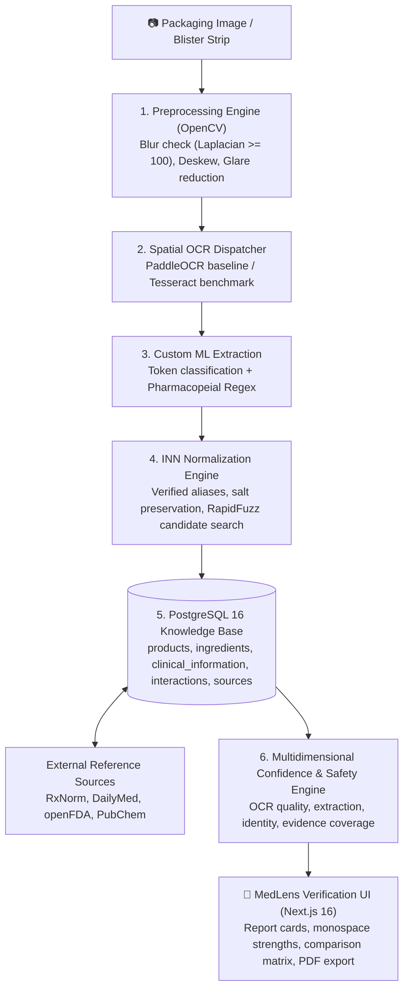

<div align="center">

# 🔬 MedLens
### *Verification-First Medicine Composition Analyzer & Pharmaceutical Intelligence*

**Decoding packaging typography • Normalizing chemical salts • Deterministic verification • Preventing adverse events**

[](https://nextjs.org/)
[](https://react.dev/)
[](https://www.typescriptlang.org/)
[](https://fastapi.tiangolo.com/)
[](https://python.org/)
[](https://tailwindcss.com/)
[](./LICENSE)

<p align="center">
  <b>An image-first clinical verification engine transforming micro-printed blister strips, unreadable packaging foils, and complex chemical salts into structured, source-backed medical truth.</b>
</p>

</div>

---

## 📑 Table of Contents

- [Project Summary](#-project-summary)
- [The Problem We Solve](#-the-problem-we-solve)
- [System Architecture](#-system-architecture)
- [Tech Stack](#-tech-stack)
- [Repository Structure](#-repository-structure)
- [Getting Started](#-getting-started)
  - [Prerequisites](#prerequisites)
  - [Backend Setup (FastAPI & Python)](#1-backend-setup-fastapi)
  - [Frontend Setup (Next.js 16)](#2-frontend-setup-nextjs-16)
- [Core Verification & Safety Model](#-core-verification--safety-model)
  - [Explicit Verification States](#explicit-verification-states)
  - [Multidimensional Confidence](#multidimensional-confidence)
  - [Deterministic Brand Comparison](#deterministic-brand-comparison)
- [API Reference](#-api-reference)
- [Testing & Quality Assurance](#-testing--quality-assurance)
- [Safety & Medical Disclaimer](#-safety--medical-disclaimer)
- [License](#-license)

---

## 💡 Project Summary

**MedLens** is an ML-powered medicine-label understanding, verification, and comparison system. It converts medicine packaging photographs into structured candidate compositions using local computer vision and domain-specific sequence labeling, normalizes candidates against verified International Nonproprietary Name (INN) aliases and chemical identifiers, checks products against source-backed pharmaceutical reference databases, and produces a transparent report with per-field verification status, auditable evidence, and explicit uncertainty.

> **Core Engineering Principle:**
> The core workflow operates **without mandatory dependencies on third-party generative AI inference APIs** (such as Gemini, OpenAI, or Claude). Knowledge is never invented or hallucinated; all claims originate from structured, peer-reviewed clinical monographs (RxNorm, openFDA, PubChem, WHO).

---

## 🚨 The Problem We Solve

1. **Illegible Packaging & Micro-Typography:** Active pharmaceutical ingredients (APIs), salt compounds, and excipients are printed in low-contrast, curved, or reflective text on metallic foils.
2. **Brand Confusion & Accidental Double-Dosing:** Patients struggle to distinguish between commercial trade names (*e.g., Dolo 650 vs. Calpol 500*) and their identical underlying chemical compound (*Paracetamol*), leading to accidental overdoses.
3. **Adverse Drug Interactions & Inactive Allergen Risks:** Consumers are often unaware of excipient allergens (e.g. parabens, tartrazine dyes, aspartame) or contraindications with chronic conditions and concurrent medications.
4. **Hallucination Risk in Generic AI:** General-purpose LLMs hallucinate medical dosages and therapeutic indications. MedLens eliminates hallucination through deterministic extraction, exact unit/basis parsing, and database-grounded verification.

---

## 🏛️ System Architecture



---

## 🛠️ Tech Stack

### Frontend & Application Layer
- **Framework:** [Next.js 16.3](https://nextjs.org/) (App Router, Turbopack)
- **Library:** [React 19](https://react.dev/)
- **Language:** [TypeScript 5](https://www.typescriptlang.org/)
- **Styling:** [Tailwind CSS v4](https://tailwindcss.com/) with clinical theme tokens and custom scrollbars
- **Smooth Scrolling:** [Lenis](https://lenis.darkroom.engineering/) (`lenis ^1.3`)
- **Camera Capture:** HTML5 WebRTC `MediaDevices.getUserMedia` API with canvas frame capture

### Backend & Orchestration Layer
- **Framework:** [FastAPI](https://fastapi.tiangolo.com/) (Async, high-performance ASGI)
- **Runtime:** Python 3.11+
- **Server:** [Uvicorn](https://www.uvicorn.org/) with standard event loop
- **Data Validation & Schemas:** [Pydantic v2](https://docs.pydantic.dev/) + `pydantic-settings`
- **Testing:** [Pytest](https://docs.pytest.org/) + `httpx` AsyncClient

### Machine Learning & Computer Vision (Planned / In Pipeline)
- **Preprocessing:** OpenCV (`cv2`) & NumPy
- **OCR:** PaddleOCR v4 (primary) with Tesseract OCR (benchmark fallback)
- **Information Extraction:** PyTorch & Hugging Face Transformers (Biomedical Token Classifier)
- **Candidate Matching:** RapidFuzz & Sentence-Transformers (`all-MiniLM-L6-v2`)

### Database & Pharmaceutical Reference Layer
- **Relational Store:** PostgreSQL 16 with UUID primary keys and strict foreign-key cascades
- **Migrations:** Alembic
- **Reference Sources:** RxNorm, openFDA Drug Labeling API, PubChem PUG REST, DailyMed, WHO Essential Medicines

---

## 📂 Repository Structure

```
MedLens/
├── backend/                              # Python FastAPI Backend
│   ├── app/
│   │   ├── api/v1/                       # Versioned API routes (/health, /analyses, /products, /comparisons)
│   │   ├── core/                         # Config (pydantic-settings), errors, logging
│   │   ├── database/                     # Async session engine & clinical seeder
│   │   ├── models/                       # SQLAlchemy 2.0 ORM domain entities (11 models)
│   │   ├── repositories/                 # Product, Ingredient, Interaction & Analysis repositories
│   │   ├── schemas/                      # Pydantic v2 contracts (analysis, product, comparison, entity)
│   │   └── main.py                       # FastAPI application entry point & CORS
│   ├── migrations/                       # Alembic schema migrations
│   ├── tests/                            # Automated test suite (24 unit & integration tests)
│   ├── alembic.ini                       # Alembic database migration config
│   ├── pyproject.toml                    # Pytest configuration and packaging metadata
│   ├── requirements.txt                  # Pinned backend dependencies
│   └── .env.example                      # Backend environment template
├── frontend/                             # Next.js 16 Client Application
│   ├── app/
│   │   ├── dashboard/                    # Authenticated dashboard views
│   │   │   ├── compare/page.tsx          # Dual-brand comparison interface
│   │   │   ├── history/page.tsx          # Past scan records
│   │   │   ├── profile/page.tsx          # Personal health profile & allergy tags
│   │   │   ├── results/[id]/page.tsx     # Structured analysis report & PDF export
│   │   │   ├── scan/page.tsx             # Dropzone & WebRTC camera scanner
│   │   │   ├── layout.tsx                # Sidebar shell layout
│   │   │   └── page.tsx                  # Dashboard overview & analytics
│   │   ├── login/page.tsx                # Authentication screen
│   │   ├── privacy/page.tsx              # Privacy policy
│   │   ├── terms/page.tsx                # Terms of service
│   │   ├── globals.css                   # Tailwind CSS design system tokens
│   │   ├── layout.tsx                    # HTML root layout & SEO metadata
│   │   └── page.tsx                      # Landing page with animated sections
│   ├── components/                       # Modular UI components (report, scanner, ui)
│   ├── public/                           # Demonstration visuals and blister pack samples
│   ├── package.json                      # Frontend dependencies and scripts
│   └── tsconfig.json                     # Strict TypeScript configuration
├── docs/                                 # Project engineering documentation
│   └── IMPLEMENTATION_AUDIT.md           # Baseline audit against Capstone Blueprint
├── MedLens_Capstone_Implementation_Blueprint.md # Master engineering specification
├── LICENSE                               # MIT License
└── README.md                             # Project overview & documentation
```

---

## 🚀 Getting Started

### Prerequisites
- **Node.js:** `v18.17.0` or higher (Node.js 20+ recommended)
- **Python:** `v3.11` or higher
- **Package Managers:** `npm` (Node) and `pip` (Python)
- **Git**

---

### 1. Backend Setup (FastAPI)

1. Open a terminal and navigate to the backend directory:
   ```bash
   cd backend
   ```

2. *(Optional but recommended)* Create and activate a virtual environment:
   ```bash
   # Windows (PowerShell)
   python -m venv .venv
   .\.venv\Scripts\Activate.ps1

   # macOS / Linux
   python3 -m venv .venv
   source .venv/bin/activate
   ```

3. Install backend dependencies:
   ```bash
   pip install -r requirements.txt
   ```

4. Create your local environment file:
   ```bash
   copy .env.example .env   # Windows
   # cp .env.example .env   # macOS / Linux
   ```

5. Initialize and seed the clinical database (idempotent):
   ```bash
   python -m app.database.seed
   ```

6. Run the automated test suite:
   ```bash
   python -m pytest tests/
   ```
   *(Expected output: 31/31 tests passing in ~1s)*

7. Start the local API development server:
   ```bash
   uvicorn app.main:app --reload --port 8000
   ```
   - API Root: [http://localhost:8000](http://localhost:8000)
   - Interactive Swagger Docs: [http://localhost:8000/docs](http://localhost:8000/docs)
   - OpenAPI Specification: [http://localhost:8000/api/v1/openapi.json](http://localhost:8000/api/v1/openapi.json)

---

### 2. Frontend Setup (Next.js 16)

1. Open a separate terminal and navigate to the frontend directory:
   ```bash
   cd frontend
   ```

2. Install dependencies:
   ```bash
   npm install
   ```

3. Run linting checks:
   ```bash
   npm run lint
   ```

4. Start the local frontend development server:
   ```bash
   npm run dev
   ```

5. Open your browser and navigate to:
   ```
   http://localhost:3000
   ```

6. To compile an optimized production bundle:
   ```bash
   npm run build
   npm run start
   ```

---

## 🧪 Core Verification & Safety Model

### Explicit Verification States
MedLens never makes binary guesses or assumes missing information is safe. Every field resolves to one of four states:
- **`verified`**: The candidate meets strict identity, formulation, and clinical evidence rules.
- **`partially_verified`**: Core attributes are supported, but certain fields (e.g. exact release mechanism or salt basis) remain unconfirmed.
- **`needs_confirmation`**: Meaningful ambiguity exists (e.g. multiple salt candidates); the user is prompted to confirm.
- **`unable_to_verify`**: Available evidence is conflicting or insufficient. No synthetic facts are invented.

### Multidimensional Confidence
Rather than displaying a misleading single "medical accuracy percentage", MedLens reports calibrated, discrete dimensions:
1. **OCR Quality ($0.0 - 1.0$):** Transcription fidelity from optical recognition.
2. **Extraction Quality ($0.0 - 1.0$):** Precision of detected entity spans and token classification.
3. **Identity Confidence ($0.0 - 1.0$):** Statistical support for canonical INN mapping.
4. **Evidence Coverage ($0.0 - 1.0$):** Proportion of claims grounded in consulted regulatory monographs.

### Deterministic Brand Comparison
Comparing two products (e.g. *Dolo 650* vs. *Calpol 500*) evaluates:
1. **Active Salt Match:** Multiset equality check against canonical INN identities.
2. **Dosage Strength Delta:** Mathematical delta ($\Delta = 650\text{ mg} - 500\text{ mg} = +150\text{ mg}$) with daily accumulation warnings.
3. **Excipient Variance Diff:** Identifies potential allergen differences (e.g. sodium methylparaben, aspartame, food colorants).
4. **Therapeutic Equivalence Boundary:** Therapeutic bioequivalence is **never claimed** unless supported by product-specific regulatory filings.

---

## 📡 API Reference

All backend endpoints are versioned under `/api/v1`:

| Method | Endpoint | Description | Status Code |
|---|---|---|---|
| `GET` | `/api/v1/health` | Service liveness probe and environment health | `200 OK` |
| `POST` | `/api/v1/analyses` | Uploads packaging image for intake validation & queuing | `202 Accepted` |
| `GET` | `/api/v1/analyses/{id}` | Retrieves full verification report and clinical claims | `200 OK` |
| `GET` | `/api/v1/products/search?q=...` | Searches normalized products catalog by query string | `200 OK` |
| `GET` | `/api/v1/products/{id}` | Retrieves product detail and formulation composition | `200 OK` |
| `POST` | `/api/v1/comparisons` | Computes deterministic comparison between two products | `200 OK` |

---

## 🛡️ Testing & Quality Assurance

Both frontend and backend layers maintain automated quality gates:

- **Backend Pytest Suite:**
  - `tests/test_health.py`: Validates health probes and OpenAPI schema completeness.
  - `tests/test_schemas.py`: Asserts strict Pydantic v2 validation (e.g., rejecting negative strengths, bounding confidence to $[0.0, 1.0]$).
  - `tests/test_errors.py`: Asserts uniform error responses and image MIME rejection.
  - **Status:** `10 passed in 0.40s`
- **Frontend Quality:**
  - `npm run lint`: ESLint with Next.js 16 and React 19 rules (**0 errors**).
  - `npm run build`: Production compilation via Turbopack (**13/13 static routes generated cleanly**).

---

## ⚖️ Safety & Medical Disclaimer

> [!IMPORTANT]
> **MedLens is an informational assistive tool and does NOT provide medical advice, clinical diagnoses, or prescriptions.**
> Always consult a qualified physician or licensed pharmacist before starting, changing, or discontinuing any medication regimen. In case of a suspected adverse drug event, accidental overdose, or medical emergency, immediately contact your local emergency services or national poison control center.

---

## 📄 License

This project is licensed under the [MIT License](LICENSE).
