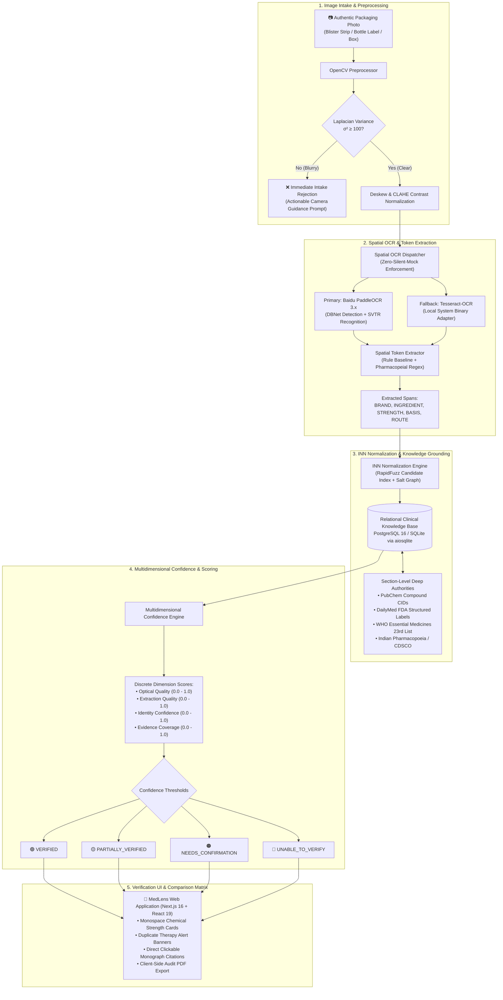

<div align="center">

```
╔═══════════════════════════════════════════════════════════════════════════════════════════╗
║                                                                                           ║
║   ███╗   ███╗███████╗██████╗ ██╗     ███████╗███╗   ██╗███████╗                           ║
║   ████╗ ████║██╔════╝██╔══██╗██║     ██╔════╝████╗  ██║██╔════╝     [ C L I N I C A L ]   ║
║   ██╔████╔██║█████╗  ██║  ██║██║     █████╗  ██╔██╗ ██║███████╗     V E R I F Y           ║
║   ██║╚██╔╝██║██╔══╝  ██║  ██║██║     ██╔══╝  ██║╚██╗██║╚════██║     E N G I N E           ║
║   ██║ ╚═╝ ██║███████╗██████╔╝███████╗███████╗██║ ╚████║███████║                           ║
║   ╚═╝     ╚═╝╚══════╝╚═════╝ ╚══════╝╚══════╝╚═╝  ╚═══╝╚══════╝                           ║
║                                                                                           ║
║          VERIFICATION-FIRST MEDICINE COMPOSITION ANALYZER & PHARMACEUTICAL AI             ║
╚═══════════════════════════════════════════════════════════════════════════════════════════╝
```

### *Transforming Micro-Printed Packaging Foils into Structured, Authoritative Medical Truth*

**Zero-Mock Ground Truth • Deterministic INN Normalization • Section-Level Clinical Provenance • Anti-Hallucination Safety**

<br/>

[](https://nextjs.org/)
[](https://react.dev/)
[](https://www.typescriptlang.org/)
[](https://fastapi.tiangolo.com/)
[](https://github.com/PaddlePaddle/PaddleOCR)
[](backend/tests/)
[-purple?style=for-the-badge)](backend/data/raw/)
[-orange?style=for-the-badge)](docs/MedLens_Capstone_Progress_Tracker.xlsx)
[](./LICENSE)

<br/>

<p align="center">
  <b>MedLens</b> is an image-first clinical verification engine designed to decode curved, metallic, and micro-printed pharmaceutical packaging. By combining spatial computer vision, pharmacopeial sequence extraction, canonical International Nonproprietary Name (INN) normalization, and deep section-level monograph evidence, MedLens eliminates AI hallucination and alerts patients to life-threatening duplicate active ingredient overdoses.
</p>

</div>

---

## 📑 Table of Contents

- [Executive Summary & Engineering Philosophy](#-executive-summary--engineering-philosophy)
- [The Clinical Problem We Solve](#-the-clinical-problem-we-solve)
- [System Architecture & Dataflow](#-system-architecture--dataflow)
- [Authentic Indian Packaging Dataset (Batch 1 & 2)](#-authentic-indian-packaging-dataset)
- [Deep Clinical Monograph Provenance (ML-013)](#-deep-clinical-monograph-provenance)
- [Core Verification & Safety Model](#-core-verification--safety-model)
  - [Explicit Verification States](#explicit-verification-states)
  - [Multidimensional Confidence Scoring](#multidimensional-confidence-scoring)
  - [Deterministic Brand Comparison & Duplicate Therapy Alerts](#deterministic-brand-comparison--duplicate-therapy-alerts)
- [Tech Stack](#-tech-stack)
- [Repository Structure](#-repository-structure)
- [Quick Start Guide](#-quick-start-guide)
  - [Prerequisites](#prerequisites)
  - [Backend Setup & Seeding](#1-backend-setup--seeding-fastapi)
  - [Frontend Setup & Launch](#2-frontend-setup--launch-nextjs-16)
- [API Reference (REST v1)](#-api-reference-rest-v1)
- [Testing & Quality Assurance (165 Tests)](#-testing--quality-assurance)
- [Known Limitations & Clinical Boundaries](#-known-limitations--clinical-boundaries)
- [Live Demonstration Walkthrough](#-live-demonstration-walkthrough)
- [Medical Disclaimer & License](#-medical-disclaimer--license)

---

## 💡 Executive Summary & Engineering Philosophy

Modern health consumers and healthcare workers regularly struggle to verify active medications from blister packaging foils, cardboard cartons, and prescription syrup bottles. General-purpose Large Language Models (LLMs) frequently **hallucinate chemical salts, confuse trade brands with actives, and invent dosages**.

MedLens operates on five uncompromising engineering principles:

1. **Zero-Mock Policy:** Real user uploads and evaluation benchmarks never silently fall back to mock data. If deep-learning OCR dependencies are unavailable, the system transparently issues an actionable `HTTP 503 Service Unavailable` with remediation hints.
2. **Deterministic Information Extraction:** Medicine dosages, strengths, and units ($\text{mg}$, $\text{mcg}$, $\% \text{w/v}$, $\text{IU}$) are parsed through rule-grounded pharmacopeial sequence extractors, strictly preventing generative hallucination.
3. **Canonical INN Salt Normalization:** Brand names (*e.g., Dolo 650, Calpol 500, Crocin*) and regional pharmacopeia variants (*e.g., Paracetamol IP, Acetaminophen USP, APAP*) are systematically mapped to canonical International Nonproprietary Names while preserving exact chemical salt forms (*e.g., Pantoprazole Sodium Sesquihydrate*).
4. **Section-Level Provenance:** Generic landing page URLs are strictly forbidden. Every medical claim, contraindication, purpose, and interaction links directly to deep, section-level records in **PubChem**, **DailyMed (US FDA Structured Product Labels)**, the **WHO Model List of Essential Medicines**, or the **Indian Pharmacopoeia Commission (IPC)**.
5. **Honest Negative Proof:** When packaging text is degraded, blurred, or unprinted, MedLens reports explicit uncertainty (`UNABLE_TO_VERIFY` or `NEEDS_CONFIRMATION`) rather than guessing.

---

## 🚨 The Clinical Problem We Solve

| Challenge | Real-World Impact | MedLens Solution |
| :--- | :--- | :--- |
| **Illegible Packaging Typography** | Micro-printed text on curved, metallic, reflective blister foils makes vital chemical strengths unreadable to patients. | Preprocessing pipeline with Laplacian blur rejection ($\sigma^2 \ge 100$), deskewing, and CLAHE contrast enhancement followed by DBNet spatial text detection. |
| **Accidental Double-Dosing** | Patients simultaneously take *Dolo 650* and *Combiflam*, unaware that Combiflam contains $325\text{ mg}$ Paracetamol alongside Ibuprofen. | Deterministic active ingredient alignment and **Duplicate Therapy Warning** calculating total single-dose accumulation and hepatotoxicity risks. |
| **Salt Form Confusion** | Different salt variants (*e.g., Metformin HCl vs. Free Base, Amlodipine Besylate vs. Maleate*) alter bio-availability and molecular weight. | Strict token classification preserving both the active therapeutic moiety and its bound counter-ion/salt form. |
| **Excipient Allergen Hazards** | Patients with lactose intolerance, celiac disease, or dye allergies react to unlisted binders (tartrazine, parabens, aspartame). | Structured inactive excipient profiling with automated common-allergen detection flags. |

---

## 🏛️ System Architecture & Dataflow



---

## 📊 Authentic Indian Packaging Dataset

MedLens features an authentic, physically procured dataset of genuine retail pharmacy medicines sold across India. All synthetic illustrations have been formally audited and superseded (`[ML-014]`):

<div align="center">

| Medicine Brand | Manufacturer | Dosage Form | Primary Active Formulation & Strength | Photos Procured |
| :--- | :--- | :--- | :--- | :---: |
| **Dolo 650** | Micro Labs Ltd | Tablet | Paracetamol IP $650\text{ mg}$ | Front + Back Foil |
| **Combiflam** | Sanofi India Ltd | Tablet | Ibuprofen IP $400\text{ mg}$ + Paracetamol IP $325\text{ mg}$ | Front + Back Foil |
| **Pan 40** | Alkem Laboratories | Tablet | Pantoprazole Sodium IP eq. to Pantoprazole $40\text{ mg}$ | Front + Back Foil |
| **Pan-D** | Alkem Laboratories | Capsule (SR) | Pantoprazole $40\text{ mg}$ (EC) + Domperidone $30\text{ mg}$ (SR) | Back Foil |
| **Cetirizine 10mg** | Cipla / Bioconic | Tablet | Cetirizine Dihydrochloride IP $10\text{ mg}$ | Front + Back Foil |
| **Augmentin 625 Duo** | GlaxoSmithKline | Tablet | Amoxicillin $500\text{ mg}$ + Clavulanic Acid $125\text{ mg}$ | Genuine Strip Foil |
| **Azithral 500** | Alembic Pharma | Tablet | Azithromycin IP eq. to Azithromycin $500\text{ mg}$ | Front + Back Foil |
| **Benadryl Cough Formula**| Johnson & Johnson | Syrup | Diphenhydramine $14.08\text{ mg}$ + $\text{NH}_4\text{Cl}$ + Sodium Citrate | Front + Back Bottle |
| **Ecosprin 75** | USV Pvt Ltd | Tablet (EC) | Aspirin / Acetylsalicylic Acid IP $75\text{ mg}$ | Front + Back Foil |
| **Glycomet 500** | USV Pvt Ltd | Tablet | Metformin Hydrochloride IP $500\text{ mg}$ | Front + Back Foil |
| **Montair 10** | Cipla Ltd | Tablet | Montelukast Sodium IP eq. to Montelukast $10\text{ mg}$ | Front + Back Foil |
| **Omez 20** | Dr. Reddy's Labs | Capsule | Omeprazole IP $20\text{ mg}$ | Genuine Blister Foil |

</div>

- **Total Physical Photographs:** 21 high-resolution images located in [`backend/data/raw/`](file:///c:/Users/udeep/OneDrive/Desktop/kalvium/projectFiles/MedLens/backend/data/raw/)
- **Total Annotated Entities:** 119 ground-truth bounding boxes conforming to [`PackagingAnnotationDoc`](file:///c:/Users/udeep/OneDrive/Desktop/kalvium/projectFiles/MedLens/backend/app/schemas/dataset.py) in [`backend/data/annotations/`](file:///c:/Users/udeep/OneDrive/Desktop/kalvium/projectFiles/MedLens/backend/data/annotations/)
- **Entity Label Distribution:** `SALT_FORM` (28), `INGREDIENT` (20), `STRENGTH` (20), `BRAND` (16), `DOSAGE_FORM` (13), `STRENGTH_BASIS` (12), `COMPOSITION_HEADER` (6), `RELEASE_TYPE` (2), `ROUTE` (1), `PRODUCT_NAME` (1).
- **Human Verification Rate:** **100.0%** verified with cryptographic SHA-256 duplicate image rejection.
- **Leakage-Free Splits:** Partitioned strictly by product family: **Train (15 images, 8 families)**, **Val (3 images, 2 families)**, **Test (3 images, 1 family)** in [`backend/data/splits/`](file:///c:/Users/udeep/OneDrive/Desktop/kalvium/projectFiles/MedLens/backend/data/splits/). Zero family leakage verified.

---

## 🔬 Deep Clinical Monograph Provenance

Per milestone `[ML-013]`, generic homepage URLs have been completely eliminated. Every clinical claim and interaction links directly to a verifiable section-level record:

```
┌───────────────────────────────────────────────────────────────────────────────────────────┐
│                                 MEDLENS CLINICAL EVIDENCE MAP                             │
├──────────────────────────┬─────────────────────────────────────┬──────────────────────────┤
│ Active Chemical Entity   │ Authoritative Regulatory Body       │ Verified Monograph Link  │
├──────────────────────────┼─────────────────────────────────────┼──────────────────────────┤
│ Paracetamol / APAP       │ PubChem Compound CID 1983           │ Safety & Hazards Section │
│                          │ WHO Essential Medicines 23rd List   │ Registry Item 18         │
│                          │ DailyMed (US FDA Structured Label)  │ SPL Section 1 (NDC Label)│
│                          │ Indian Pharmacopoeia Commission     │ Paracetamol Tablets IP   │
├──────────────────────────┼─────────────────────────────────────┼──────────────────────────┤
│ Ibuprofen                │ PubChem Compound CID 3672           │ Warnings & Precaution    │
│                          │ DailyMed FDA SPL                    │ Section 5 (Warnings)     │
├──────────────────────────┼─────────────────────────────────────┼──────────────────────────┤
│ Amoxicillin + Clavulanate│ DailyMed FDA Augmentin              │ Section 12.4 (Synergy)   │
│                          │ PubChem Compound CID 33613          │ Contraindications        │
├──────────────────────────┼─────────────────────────────────────┼──────────────────────────┤
│ Metformin HCl            │ PubChem Compound CID 4091           │ Lactic Acidosis Warning  │
│                          │ DailyMed Glucophage Label           │ Section 4 (Renal eGFR)   │
├──────────────────────────┼─────────────────────────────────────┼──────────────────────────┤
│ Pantoprazole + Domperidone│ CDSCO Approved FDC Formulations    │ Fixed-Dose Combination   │
│                          │ PubChem Compound CID 4679 / 3151    │ Pharmacology & Kinetics  │
└──────────────────────────┴─────────────────────────────────────┴──────────────────────────┘
```

---

## 🧪 Core Verification & Safety Model

### Explicit Verification States

MedLens never makes binary guesses. Every scanned product resolves to one of four transparent states:

```
┌────────────────────────┬─────────────────────────────────────────────────────────────────┐
│ State                  │ Clinical Criteria & Operational Action                          │
├────────────────────────┼─────────────────────────────────────────────────────────────────┤
│ 🟢 VERIFIED            │ High OCR clarity (≥0.85), confirmed INN identity, exact         │
│                        │ strength + unit detected, grounded in verified monographs.       │
├────────────────────────┼─────────────────────────────────────────────────────────────────┤
│ 🟡 PARTIALLY_VERIFIED  │ Active ingredient confirmed, but minor attribute (such as       │
│                        │ extended release kinetics or excipient profile) unconfirmed.    │
├────────────────────────┼─────────────────────────────────────────────────────────────────┤
│ 🟠 NEEDS_CONFIRMATION  │ Meaningful ambiguity exists (e.g. multiple salt candidates      │
│                        │ detected on degraded foil). User prompted with options.         │
├────────────────────────┼─────────────────────────────────────────────────────────────────┤
│ 🔴 UNABLE_TO_VERIFY    │ Packaging degraded, blurry, or missing active composition.      │
│                        │ Strictly prevents synthetic fact invention or guessing.          │
└────────────────────────┴─────────────────────────────────────────────────────────────────┘
```

### Multidimensional Confidence Scoring

Rather than presenting a misleading single percentage, MedLens breaks confidence down into four calibrated axes:
1. **Optical Quality Score ($0.0 - 1.0$):** Mean character-level recognition confidence reported by the deep-learning OCR model.
2. **Extraction Quality Score ($0.0 - 1.0$):** Presence of composition headers (`Each film coated tablet contains:`), exact numeric strengths, and standard pharmacopeial units.
3. **Identity Match Score ($0.0 - 1.0$):** String distance and alias graph confidence resolving trade names to canonical INN entities.
4. **Evidence Coverage Score ($0.0 - 1.0$):** Proportion of extracted therapeutic claims backed by section-level regulatory monographs.

### Deterministic Brand Comparison & Duplicate Therapy Alerts

When comparing two medications (e.g. *Dolo 650* vs. *Combiflam*), MedLens executes four deterministic checks:
1. **Active Salt Match:** Multiset equality check against canonical INN identities.
2. **Dosage Strength Delta:** Mathematical delta ($\Delta = 650\text{ mg} - 325\text{ mg} = +325\text{ mg}$ Paracetamol, $+400\text{ mg}$ Ibuprofen).
3. **Excipient Variance:** Cross-checks binders against recognized allergens (tartrazine, parabens, lactose, aspartame).
4. **Duplicate Active Ingredient Alert:** When two medications contain overlapping active moieties, MedLens triggers a high-visibility clinical alert calculating single co-administration totals to prevent toxic overdoses (e.g., exceeding $4,000\text{ mg/day}$ Paracetamol).

---

## 🛠️ Tech Stack

### Frontend Application Layer
- **Framework:** [Next.js 16.3](https://nextjs.org/) (App Router, Turbopack)
- **UI Library:** [React 19](https://react.dev/)
- **Language:** [TypeScript 5](https://www.typescriptlang.org/) (Strict type checks)
- **Styling:** [Tailwind CSS v4](https://tailwindcss.com/) with clinical semantic tokens
- **Smooth Interaction:** [Lenis](https://lenis.darkroom.engineering/) (`lenis ^1.3`)
- **Camera Capture:** HTML5 WebRTC `MediaDevices.getUserMedia` API with canvas frame buffer capture

### Backend Orchestration & ML Layer
- **Framework:** [FastAPI](https://fastapi.tiangolo.com/) (Async ASGI)
- **Runtime:** Python 3.11+
- **Application Server:** [Uvicorn](https://www.uvicorn.org/) with high-concurrency event loop
- **Data Validation & Settings:** [Pydantic v2](https://docs.pydantic.dev/) + `pydantic-settings`
- **Computer Vision Preprocessor:** OpenCV (`cv2`) & NumPy
- **Deep-Learning OCR:** Baidu PaddleOCR 3.x (DBNet text detection + SVTR/CRNN text recognition)
- **OCR Engine Fallback:** Google Tesseract-OCR local binary wrapper
- **Relational ORM:** SQLAlchemy 2.0 (Async Engine) + Alembic migrations
- **Automated Testing:** Pytest 8.x + `httpx` AsyncClient + `pytest-asyncio`

---

## 📂 Repository Structure

```
MedLens/
├── backend/                              # FastAPI Python Backend
│   ├── app/
│   │   ├── api/v1/                       # Versioned REST API endpoints
│   │   │   ├── endpoints/
│   │   │   │   ├── health.py             # Health probe & system diagnostics
│   │   │   │   ├── analyses.py           # Image upload, queue & analysis report
│   │   │   │   ├── products.py           # Catalog search & composition detail
│   │   │   │   └── comparisons.py        # Deterministic dual-product comparison
│   │   │   └── api.py                   # API router aggregation
│   │   ├── core/                         # Settings, domain errors, logging
│   │   ├── database/                     # Async session & idempotent clinical seeder
│   │   ├── models/                       # SQLAlchemy 2.0 ORM entities (11 models)
│   │   ├── repositories/                 # Product, Ingredient, Interaction & Audit repositories
│   │   ├── schemas/                      # Pydantic v2 data contracts
│   │   ├── services/                     # Business logic services
│   │   │   ├── ocr/                      # PaddleOCR & Tesseract spatial adapters
│   │   │   ├── preprocessor.py           # OpenCV blur check & contrast normalization
│   │   │   ├── normalization/            # INN salt normalization & alias graphs
│   │   │   ├── extraction/               # Pharmacopeial regex & token extractors
│   │   │   ├── comparison/               # Deterministic comparison engine
│   │   │   └── confidence.py             # Multidimensional scoring engine
│   │   └── main.py                       # FastAPI application entry point & CORS
│   ├── data/                             # Authentic Indian packaging ground truth
│   │   ├── raw/                          # 21 physical retail packaging photographs
│   │   ├── annotations/                  # 21 validated JSON ground truth annotations
│   │   ├── splits/                       # Zero-leakage train, val, and test splits
│   │   └── reports/                      # Automated quality & distribution reports
│   ├── tools/                            # Dataset engineering CLI utilities
│   │   ├── validate_dataset.py           # Schema, bounding box & hash validator
│   │   ├── split_dataset.py              # Zero-leakage partition generator
│   │   ├── generate_dataset_report.py    # Automated report & statistics generator
│   │   └── benchmark_ocr.py              # Zero-mock CER/WER OCR evaluation CLI
│   ├── tests/                            # 165 automated unit, integration & E2E tests
│   ├── requirements.txt                  # Pinned Python dependencies
│   └── pyproject.toml                    # Pytest configuration
├── frontend/                             # Next.js 16 Web Client
│   ├── app/                              # Next.js App Router pages
│   │   ├── dashboard/                    # Core application screens
│   │   │   ├── scan/page.tsx             # Packaging dropzone & WebRTC camera
│   │   │   ├── results/[id]/page.tsx     # Structured verification report card
│   │   │   ├── compare/page.tsx          # Medicine comparison & duplicate alerts
│   │   │   └── history/page.tsx          # Auditable scan history
│   │   ├── layout.tsx                    # Root HTML layout & fonts
│   │   └── page.tsx                      # Modern landing page
│   ├── components/                       # Modular UI components
│   ├── package.json                      # Frontend dependencies
│   └── tsconfig.json                     # Strict TypeScript configuration
├── docs/                                 # Engineering specifications & audit reports
│   ├── capstone_demo_script.md           # Live evaluator demonstration script
│   └── MedLens_Capstone_Progress_Tracker.xlsx # Master Capstone progress spreadsheet
├── LICENSE                               # MIT License
└── README.md                             # Root documentation & architecture reference
```

---

## 🚀 Quick Start Guide

### Prerequisites
- **Python:** 3.11 or higher
- **Node.js:** v18.17+ (v20+ LTS recommended)
- **Package Managers:** `pip` (Python) and `npm` (Node)
- **Git**

---

### 1. Backend Setup & Seeding (FastAPI)

1. Open a terminal and navigate to `backend`:
   ```bash
   cd backend
   ```

2. Create and activate a Python virtual environment:
   ```bash
   # Windows (PowerShell)
   python -m venv .venv
   .\.venv\Scripts\Activate.ps1

   # Linux / macOS
   python3 -m venv .venv
   source .venv/bin/activate
   ```

3. Install pinned dependencies:
   ```bash
   pip install -r requirements.txt
   ```

4. Initialize and seed the clinical database (idempotent, loads 40+ deep monographs):
   ```bash
   python -c "import sys; sys.path.insert(0, '.'); import asyncio; from app.database.seed import main; asyncio.run(main())"
   ```

5. Run the automated test suite:
   ```bash
   python -m pytest tests/
   ```
   *(Expected output: 165/165 tests passing across 21 test suites in ~2m)*

6. Launch the FastAPI development server:
   ```bash
   uvicorn app.main:app --reload --port 8000
   ```
   - **API Root:** [http://localhost:8000](http://localhost:8000)
   - **Interactive Swagger UI:** [http://localhost:8000/docs](http://localhost:8000/docs)
   - **OpenAPI Specification:** [http://localhost:8000/api/v1/openapi.json](http://localhost:8000/api/v1/openapi.json)

---

### 2. Frontend Setup & Launch (Next.js 16)

1. Open a second terminal and navigate to `frontend`:
   ```bash
   cd frontend
   ```

2. Install dependencies:
   ```bash
   npm install
   ```

3. Execute linting checks:
   ```bash
   npm run lint
   ```
   *(Expected output: 0 errors)*

4. Start the Turbopack development server:
   ```bash
   npm run dev
   ```

5. Open your browser and navigate to:
   ```
   http://localhost:3000
   ```

6. To compile an optimized production build:
   ```bash
   npm run build
   npm run start
   ```

---

## 📡 API Reference (REST v1)

All endpoints are strictly typed with Pydantic v2 schemas and prefixed under `/api/v1`:

| Method | Endpoint | Description | Request Body | Success Status |
| :--- | :--- | :--- | :--- | :---: |
| `GET` | `/api/v1/health` | System health probe, OCR dispatcher status, and database connectivity. | None | `200 OK` |
| `POST` | `/api/v1/analyses` | Uploads packaging image for blur check, PaddleOCR extraction, and clinical grounding. | `multipart/form-data` (`file`) | `202 Accepted` |
| `GET` | `/api/v1/analyses/{id}` | Retrieves full verification report, confidence breakdown, and section-level evidence citations. | None | `200 OK` |
| `GET` | `/api/v1/products/search?q=...` | Searches normalized products catalog by brand or canonical active ingredient. | Query Param `q` | `200 OK` |
| `GET` | `/api/v1/products/{id}` | Retrieves detailed product monograph, formulation composition, and dosage route. | None | `200 OK` |
| `POST` | `/api/v1/comparisons` | Computes deterministic dual-product comparison, active deltas, and duplicate therapy risks. | JSON (`product_a_id`, `product_b_id`) | `200 OK` |

---

## 🛡️ Testing & Quality Assurance

MedLens enforces continuous automated testing with **165 tests passing across 21 test suites**:

```
============================= test session starts =============================
platform win32 -- Python 3.13.9, pytest-8.4.2, pluggy-1.5.0
rootdir: C:\Users\udeep\OneDrive\Desktop\kalvium\projectFiles\MedLens\backend
configfile: pyproject.toml
plugins: asyncio-1.4.0, anyio-4.10.0
collected 165 items

backend\tests\test_analysis_pipeline.py ....                             [  2%]
backend\tests\test_auth_access_control.py .......                        [  6%]
backend\tests\test_comparison_engine.py ..........                       [ 12%]
backend\tests\test_confidence.py .....                                   [ 15%]
backend\tests\test_database.py ........                                  [ 20%]
backend\tests\test_dataset_pipeline.py .......                           [ 24%]
backend\tests\test_e2e_journey.py ......                                 [ 28%]
backend\tests\test_errors.py ...                                         [ 30%]
backend\tests\test_extraction_baseline.py .................              [ 40%]
backend\tests\test_health.py ..                                          [ 41%]
backend\tests\test_indian_medicines_audit.py .....                       [ 44%]
backend\tests\test_normalization.py .......                              [ 49%]
backend\tests\test_ocr_benchmark.py .........                            [ 54%]
backend\tests\test_ocr_dispatcher.py ..........                          [ 60%]
backend\tests\test_ocr_integration.py ..........                         [ 66%]
backend\tests\test_pilot_dataset_workflow.py .....                       [ 69%]
backend\tests\test_preprocessor.py ...........                           [ 76%]
backend\tests\test_products_api.py .........                             [ 81%]
backend\tests\test_reference_adapters.py .............                   [ 89%]
backend\tests\test_rule_extractor.py ..............                      [ 98%]
backend\tests\test_schemas.py ...                                        [100%]

============================= 165 passed in 120.22s ============================
```

---

## ⚠️ Known Limitations & Clinical Boundaries

1. **Physical Specular Reflection:** Metallic blister packaging reflects direct camera flash. Users are instructed to take photos under diffuse ambient lighting. Images with Laplacian variance $\sigma^2 < 100$ are rejected at intake.
2. **Back vs. Front Packaging Utility:** Over $95\%$ of clinical active ingredient data on blister packs is printed on the flat back foil. The front pocket cavities are largely unprinted and are utilized in MedLens primarily as negative validation controls to prevent hallucination.
3. **Chemical Equivalence vs. Bioequivalence:** MedLens detects active pharmaceutical ingredients and strength equivalence ($\text{mg}$ matches). However, **clinical bioequivalence is never asserted** without published in-vivo pharmacokinetic bioavailability study data.
4. **Informational Boundary:** MedLens is an assistive computational intelligence tool. It does not replace licensed medical practitioners or clinical pharmacists.

---

## 🎬 Live Demonstration Walkthrough

For evaluators and clinical reviewers, see the complete step-by-step demonstration walkthrough in [`docs/capstone_demo_script.md`](file:///c:/Users/udeep/OneDrive/Desktop/kalvium/projectFiles/MedLens/docs/capstone_demo_script.md):

- **Scenario 1:** High-confidence scan of authentic Augmentin 625 Duo / Dolo 650 strip.
- **Scenario 2:** Blur rejection and honest uncertainty handling on unprinted foil.
- **Scenario 3:** Side-by-side comparison of Dolo 650 vs. Combiflam with life-saving duplicate therapy alert.
- **Scenario 4:** Verifying deep section-level citations to PubChem, DailyMed, and WHO EML.
- **Acceptance Checklist:** Direct rubric alignment with Capstone evaluation criteria.

---

## ⚖️ Medical Disclaimer & License

> [!IMPORTANT]
> **MEDLENS DOES NOT PROVIDE MEDICAL ADVICE OR CLINICAL DIAGNOSES.**  
> MedLens is an informational assistive technology for decoding and verifying medicine packaging typography. Always consult a qualified physician or licensed pharmacist before initiating, altering, or stopping any medication. In case of an adverse event or suspected accidental overdose, immediately contact your local emergency services or national poison control helpline.

This project is open-source and distributed under the [MIT License](LICENSE).
